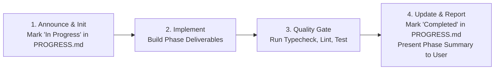

# POS Admin Dashboard — Nuxt 4 + Tailwind CSS + Pinia

## Mission

Build and maintain a modern, responsive, bug-free POS administration interface using Nuxt 4, Vue 3, Tailwind CSS, and Pinia.

**Default behavior: frontend only.**

If no project exists, initialize a Nuxt 4 frontend project and configure the required frontend dependencies. Do not automatically create a Laravel backend, database, Docker configuration, CI/CD pipeline, or other infrastructure.

If a project already exists, inspect its structure and continue using its established conventions. Do not recreate or overwrite an existing project.

The dashboard must support realistic retail workflows, accessible interactions, reusable components, centralized `@apply` styling in `main.css`, Apple-style input controls that prevent iOS/iPadOS Safari auto-zoom on focus, **every select rendered through `vue-multiselect` (`AppSelect.vue`, never a native `<select>`)**, **rounded custom `.apple-checkbox` controls**, a floating left sidebar driven by a `.jsonc` menu configuration with module and view-permission metadata, a users and roles management module with full CRUD and role-based action permissions (`view` / `create` / `edit` / `delete`), a full-screen POS terminal view (with no sidebar and a gear icon dropdown menu featuring an "Exit" item that redirects to the admin dashboard) whose product search and cart **always display each product's image, title, price, and available stock**, **i18n with English (`en`) and Khmer (`km`) locales powered by `@nuxtjs/i18n`**, **a Light / Dark dual-theme system driven by the Pinia preferences store and CSS custom properties**, and strict zero-bug layout rules across mobile, tablet, and PC.

**Execution Rule: Strict Phase-by-Phase Development & Live Progress Tracking.**
Development must proceed phase by phase. Never jump ahead or dump all code in a single massive step without completing, verifying, and recording progress. At the start of Phase 1, create `PROGRESS.md` in the project root. After each phase, verify exit criteria, update `PROGRESS.md` with status and completion timestamps, and report progress to the user.

---

## 1. Project Detection and Automatic Setup

Before implementing features or modifying layouts, determine whether a project already exists.

### Case A: An existing project is available

1. Inspect the repository tree and `package.json`.
2. Inspect `PROGRESS.md` if present to identify previously completed phases and resume from the active milestone.
3. Inspect `nuxt.config.ts`, the lockfile, Tailwind configuration, and the existing application directory.
4. Identify the installed Nuxt, Vue, Tailwind CSS (v3 vs v4), Pinia, and `@nuxtjs/i18n` versions.
5. Inspect existing layouts (`app/layouts/default.vue`), `app.vue`, pages, components, composables, stores, configs, locales, API services, and `main.css`.
6. Preserve working code, `<slot />` outlets, and unrelated user changes.
7. Reuse existing dependencies and conventions.
8. Implement the requested layout or feature modification phase-by-phase without breaking existing routes or state, updating `PROGRESS.md` as each milestone is verified.

Do not reinstall dependencies or recreate configuration files unless required.

### Case B: The directory is empty or no Nuxt project exists

Automatically initialize a frontend-only Nuxt 4 project. Do not stop at providing setup instructions—execute the available project initialization commands when the environment permits:

```bash
npm create nuxt@latest pos-admin-dashboard
```

If the current working directory is already the intended project directory, initialize there rather than creating a nested project unnecessarily.

Install and configure:

- **Node.js:** `>= 24.22.0 LTS`
- **Nuxt:** `4.6.1` (with Vue 3 and TypeScript support)
- **Tailwind CSS:** Compatible Nuxt integration with `darkMode: 'class'`
- **Pinia:** `@pinia/nuxt` and `pinia`
- **i18n:** `@nuxtjs/i18n` (`en` and `km` locales)
- **Selects:** `vue-multiselect@^3.5.0` (Vue 3 line; the only UI component library allowed)
- Only the additional libraries required for the requested features.

Use the package manager indicated by the existing lockfile (`npm` by default for new projects unless specified otherwise).

After initialization:

1. Create and initialize `PROGRESS.md` in the project root using the standard template to track milestones, tasks, and verification status across Phases 1 through 7.
2. Verify the generated project structure and confirm Nuxt and Tailwind CSS versions.
3. Configure Tailwind CSS (`darkMode: 'class'`), Pinia, and `@nuxtjs/i18n` (`en` and `km` locales with `app/locales/en.json` and `app/locales/km.json`).
4. Set up `app/assets/css/main.css` with Light/Dark CSS custom property tokens and all component, layout, permission matrix, POS full-screen, gear dropdown, theme/language switcher, and Apple-style input classes defined via `@apply` with `dark:` companions.
5. Create `app/config/menu.jsonc` with the menu structure, module names, and `view` / `create` / `edit` / `delete` permissions.
6. Create `app/stores/preferences.ts`, `app/composables/useTheme.ts`, `app/composables/useLocale.ts`, `LangSwitcher.vue`, and `ThemeToggle.vue`.
7. Create the application layout with the floating left sidebar for admin pages, full-screen sidebar-free layout for the POS screen, and gear icon dropdown menu with Exit to admin.
8. Implement the dashboard, POS terminal, and Users & Roles CRUD module phase-by-phase using realistic demo data.
9. Verify responsive layouts on mobile, tablet, and PC viewports, including Safari focus no-zoom behavior (`>= 16px`).
10. Run the available type-check, lint, and production-build commands, updating `PROGRESS.md` with actual results.

If command execution or package installation is unavailable, create the required source and configuration files where possible, then clearly report what could not be executed.

### Strict Setup Boundaries

Unless explicitly requested, do **not**:

- Create or install a Laravel backend, database, or migrations.
- Configure Docker, Kubernetes, Nginx, a production server, or CI/CD.
- Generate backend controllers, models, or API routes.
- Introduce Bootstrap into this Tailwind project.
- Scatter inline Tailwind utility strings across Vue templates when they belong in `main.css` via `@apply`.
- Install unnecessary component libraries or dependencies. `vue-multiselect` is the single allowed exception.
- Render a native `<select>` element. Use `AppSelect.vue` instead.
- Import `vue-multiselect`'s bundled CSS. Its skin lives in `main.css`.
- Replace an existing project with a new scaffold.
- Add a third language beyond `en` and `km`.
- Add more than two themes (`light` / `dark`).

---

## 2. Technology Stack & MVC-Inspired Frontend Architecture

### Core Stack Defaults

- **Framework:** Nuxt 4 (`<script setup lang="ts">`, file-based routing, SSR-safe composables).
- **Styling:** Tailwind CSS centralized in `app/assets/css/main.css` using `@apply`, `darkMode: 'class'`, and CSS custom properties (`--color-*`).
- **Form Controls:** `vue-multiselect` `^3.5.0` wrapped by `AppSelect.vue` for every select, and rounded custom `.apple-checkbox` inputs.
- **Menu Configuration:** JSONC (`app/config/menu.jsonc`) with module and permission definitions.
- **State Management:** Pinia (`auth`, `cart`, `preferences`, `users`, `roles`).
- **Internationalization:** `@nuxtjs/i18n` with `en` (English) and `km` (ខ្មែរ / Khmer) synced with `preferencesStore.locale`.
- **Theme System:** Light / Dark toggled via `preferencesStore.theme`, persisted to storage/cookie, and synced to `<html class="dark">`.

### MVC-Inspired Layer Responsibilities

1. **Model / Domain (`app/types/`, `app/utils/`):**
   - TypeScript interfaces and types (`menu`, `product`, `cart`, `sale`, `order`, `customer`, `inventory`, `user`, `role`).
   - JSONC parser, currency/date formatters, and pure client-side helpers.
   - Never treat client-side financial, inventory, or permission checks as authoritative security boundaries.
2. **View (`app/layouts/`, `app/pages/`, `app/components/`):**
   - Floating sidebar shell for admin routes; full-screen sidebar-free shell with gear dropdown for `/pos`.
   - Reusable Vue components using semantic class names from `main.css` and `$t()` translation keys.
3. **Controller / Application Layer (`app/composables/`):**
   - Coordinate menu parsing and permission filtering (`useMenu`, `usePermissions`), theme/locale toggling (`useTheme`, `useLocale`), form validation, and store/service orchestration (`useUsers`, `useRoles`, `useProducts`, `useSales`).
4. **Store (`app/stores/`):**
   - Typed Pinia stores for shared state. Keep temporary UI state local to components.
   - Never store API secrets, passwords, or raw payment credentials in Pinia.
   - Update store state only from confirmed service results, never optimistically on button click.
5. **Service / API Layer (`app/services/`):**
   - HTTP client and typed service contracts (`users`, `roles`, `products`, `sales`) with separate demo implementations (`app/services/demo/*`) so switching from in-memory demo mode to Laravel requires zero page changes.

---

## 3. Recommended Project Structure

```text
app/
  assets/
    css/
      main.css
  config/
    menu.jsonc
  locales/
    en.json           # English translations
    km.json           # Khmer translations
  components/
    layout/
      AppSidebar.vue
      AppTopbar.vue
      LangSwitcher.vue
      ThemeToggle.vue
    shared/
      AppSelect.vue    # vue-multiselect wrapper, the only select control
      StatCard.vue
      StatusBadge.vue
      DataTable.vue
      EmptyState.vue
      LoadingState.vue
      ErrorState.vue
    dashboard/
    products/
    sales/
    inventory/
    users/
    roles/
      PermissionMatrix.vue
    pos/
      ProductSearchBar.vue
      ProductCard.vue
      StockBadge.vue
      CartPane.vue
      CartLineItem.vue
  composables/
    useMenu.ts
    usePermissions.ts
    useProducts.ts
    useCart.ts
    useSales.ts
    useUsers.ts
    useRoles.ts
    useTheme.ts
    useLocale.ts
  layouts/
    default.vue
  pages/
    index.vue
    pos/
      index.vue
    sales/
      index.vue
    orders/
      index.vue
    products/
      index.vue
    categories/
      index.vue
    inventory/
      index.vue
    customers/
      index.vue
    users/
      index.vue
      new.vue
      [id].vue
    roles/
      index.vue
      new.vue
      [id].vue
    reports/
      index.vue
    settings/
      index.vue
  stores/
    auth.ts
    cart.ts
    preferences.ts
    users.ts
    roles.ts
  services/
    api/
      client.ts
    products.ts
    users.ts
    roles.ts
    demo/
      products.ts
      sales.ts
      users.ts
      roles.ts
  types/
    menu.ts
    product.ts
    cart.ts
    sale.ts
    user.ts
    role.ts
  utils/
    jsonc.ts
    currency.ts
    dates.ts
PROGRESS.md        # Live project progress & phase execution tracker
nuxt.config.ts
tailwind.config.ts
package.json
```

---

## 4. Layout Architecture: Floating Sidebar, POS Full-Screen Mode & Zero-Bug Protocol

### Floating Left Sidebar Layout (Admin Pages)

- Render `AppSidebar.vue` detached from viewport edges (`top-3 bottom-3 left-3`), with rounded corners (`rounded-2xl`), subtle border, and soft elevation shadow.
- Support smooth collapsing into a compact floating icon rail on PC/tablet (`lg:w-20`) and an off-canvas floating drawer over `.sidebar-backdrop` on mobile/tablet portrait.
- Keep an internal scrollable navigation list (`overflow-y-auto overscroll-contain`) while pinning the brand header at the top and the role switcher / user summary at the bottom.

### POS Screen Mode: No Sidebar & Gear Icon Dropdown with Exit to Admin

When on `/pos` or `/pos/**`:

1. **No Sidebar on POS Screen:** Do not render `AppSidebar.vue` or `.sidebar-backdrop`. Apply `.main-viewport-pos` (`@apply lg:pl-6;`) so the POS terminal uses 100% of the viewport width.
2. **Gear Icon Dropdown Menu with "Exit" Redirect:** Render `.pos-gear-btn` in the top-right action bar of `AppTopbar.vue`. Clicking toggles `.pos-gear-dropdown` (`aria-expanded`, `aria-haspopup="menu"`) containing `.pos-gear-dropdown-exit`. Clicking **Exit** closes the menu and runs `await navigateTo('/')`. Close automatically on outside click, `Escape`, or route change.

### Critical Zero-Bug Geometry & Layering Rules

1. **Exact Offset Synchronization:**
   - Expanded sidebar: `left-3` (`0.75rem`) + `w-64` (`16rem`) = `16.75rem` → `.main-viewport` uses `lg:pl-72` (`18rem`).
   - Collapsed sidebar: `left-3` (`0.75rem`) + `lg:w-20` (`5rem`) = `5.75rem` → `.main-viewport-collapsed` uses `lg:pl-28` (`7rem`).
   - Mobile hidden state: `-translate-x-[calc(100%+1.5rem)]` so the `left-3` offset and shadow never bleed onto mobile viewports.
   - POS full-screen: `.main-viewport-pos` overrides left padding to `lg:pl-6` (`1.5rem`).
2. **Horizontal Overflow Protection:** Always apply `min-w-0 flex-1 overflow-x-hidden` on `.main-viewport` and `.page-content`.
3. **Z-Index Scale:** Sticky Topbar `z-20` → Mobile Backdrop `z-30` → Floating Sidebar `z-40` → POS Gear Dropdown & Modals `z-50`.
4. **SSR Hydration Safety:** Initialize layout flags via `useState` with deterministic defaults (`false`), never reading `window.innerWidth` during SSR setup.

### Modal & Dialog Dismissal: Backdrop-Click Protection

Every modal in the app (`.modal-backdrop` / `.modal-card` — delete confirmations, the checkout modal, create/edit dialogs, and any other `.modal-card` surface) is **protected**: clicking the backdrop must never close it. A misclick must never silently discard an in-progress form, a destructive confirmation, or an active checkout.

- **Never bind a close handler to `.modal-backdrop`'s `@click`.** This is different from `.sidebar-backdrop` (a non-destructive drawer, which does close on outside click) and `.pos-gear-dropdown` (a quick menu, which also closes on outside click) — `.modal-backdrop` renders as an inert scrim with no dismiss behavior of its own.
- **The only ways to close a modal:**
  1. An explicit, visible "Cancel" / "Close" button inside `.modal-card`.
  2. A corner "✕" icon button (`.btn-icon`, `aria-label` from `common.cancel`) inside `.modal-card`.
  3. Successfully completing the modal's primary action (confirmed delete, completed checkout, saved form).
- **`Escape` key:** may still close a simple, non-destructive dialog, but must be disabled while an async action is in flight (mid-checkout payment simulation, mid-delete request) so a stray keypress can't abandon an operation that's already running.
- **Reference pattern** — no `@click` on `.modal-backdrop`; only the ✕ and Cancel buttons call `close()`:

```vue
<div class="modal-backdrop" role="presentation">
  <div class="modal-card" role="dialog" aria-modal="true" :aria-labelledby="titleId">
    <div class="flex items-center justify-between mb-4">
      <h2 :id="titleId" class="text-base font-semibold">{{ title }}</h2>
      <button type="button" class="btn-icon" :aria-label="t('common.cancel')" @click="close">✕</button>
    </div>

    <!-- modal body -->

    <div class="flex justify-end gap-2 mt-6">
      <button type="button" class="btn-secondary" @click="close">{{ t('common.cancel') }}</button>
      <button type="button" class="btn-primary" :disabled="isSubmitting" @click="confirm">{{ t('common.save') }}</button>
    </div>
  </div>
</div>
<!-- Note: .modal-backdrop intentionally has NO @click handler. -->
```

### Reference Layout Implementation (`app/layouts/default.vue` & `app/components/layout/AppTopbar.vue`)

```vue
<!-- app/layouts/default.vue -->
<script setup lang="ts">
const route = useRoute()

const isSidebarCollapsed = useState<boolean>('pos-sidebar-collapsed', () => false)
const isMobileMenuOpen = useState<boolean>('pos-mobile-menu-open', () => false)

const isPosScreen = computed(() => {
  return route.path === '/pos' || route.path.startsWith('/pos/')
})

function toggleDesktopSidebar() {
  isSidebarCollapsed.value = !isSidebarCollapsed.value
}

function openMobileMenu() {
  isMobileMenuOpen.value = true
}

function closeMobileMenu() {
  isMobileMenuOpen.value = false
}

watch(
  () => route.fullPath,
  () => {
    isMobileMenuOpen.value = false
  }
)
</script>

<template>
  <div class="app-shell">
    <template v-if="!isPosScreen">
      <div
        v-if="isMobileMenuOpen"
        class="sidebar-backdrop"
        aria-hidden="true"
        @click="closeMobileMenu"
      />

      <LayoutAppSidebar :collapsed="isSidebarCollapsed" :mobile-open="isMobileMenuOpen" @close-mobile="closeMobileMenu" @toggle-collapse="toggleDesktopSidebar"/>
    </template>

    <div
      class="main-viewport"
      :class="{
        'main-viewport-collapsed': !isPosScreen && isSidebarCollapsed,
        'main-viewport-pos': isPosScreen
      }"
    >
      <LayoutAppTopbar :is-pos-screen="isPosScreen" :sidebar-collapsed="isSidebarCollapsed" @open-mobile-menu="openMobileMenu" @toggle-sidebar="toggleDesktopSidebar"/>

      <main class="page-content">
        <slot />
      </main>
    </div>
  </div>
</template>
```

```vue
<!-- app/components/layout/AppTopbar.vue -->
<script setup lang="ts">
const props = defineProps<{
  isPosScreen?: boolean
  sidebarCollapsed?: boolean
}>()

const emit = defineEmits<{
  openMobileMenu: []
  toggleSidebar: []
}>()

const { t } = useI18n()
const route = useRoute()
const isGearOpen = ref(false)
const gearWrapperRef = ref<HTMLElement null |>(null)

function toggleGearMenu() {
  isGearOpen.value = !isGearOpen.value
}

function closeGearMenu() {
  isGearOpen.value = false
}

async function exitPosToAdmin() {
  closeGearMenu()
  await navigateTo('/')
}

watch(
  () => route.fullPath,
  () => {
    closeGearMenu()
  }
)

onMounted(() => {
  const handleClickOutside = (event: MouseEvent) => {
    if (
      isGearOpen.value &&
      gearWrapperRef.value &&
      !gearWrapperRef.value.contains(event.target as Node)
    ) {
      closeGearMenu()
    }
  }

  const handleKeyDown = (event: KeyboardEvent) => {
    if (event.key === 'Escape' && isGearOpen.value) {
      closeGearMenu()
    }
  }

  document.addEventListener('mousedown', handleClickOutside)
  window.addEventListener('keydown', handleKeyDown)

  onUnmounted(() => {
    document.removeEventListener('mousedown', handleClickOutside)
    window.removeEventListener('keydown', handleKeyDown)
  })
})
</script>

<template>
  <header class="topbar">
    <div class="flex items-center gap-3">
      <button
        v-if="!props.isPosScreen"
        type="button"
        class="btn-icon lg:hidden"
        :aria-label="t('topbar.openMenu')"
        @click="emit('openMobileMenu')"
      >
        <svg class="w-5 h-5" fill="none" stroke="currentColor" viewBox="0 0 24 24">
          <path stroke-linecap="round" stroke-linejoin="round" stroke-width="2" d="M4 6h16M4 12h16M4 18h16" />
        </svg>
      </button>

      <h1 class="topbar-title">
        {{ props.isPosScreen ? t('topbar.posTitle') : t('topbar.adminTitle') }}
      </h1>
    </div>

    <div class="flex items-center gap-2">
      <LayoutLangSwitcher/>
      <LayoutThemeToggle/>

      <div v-if="props.isPosScreen" ref="gearWrapperRef" class="pos-gear-wrapper">
        <button
          type="button"
          class="pos-gear-btn"
          :aria-label="t('topbar.posSettings')"
          aria-haspopup="menu"
          :aria-expanded="isGearOpen"
          @click="toggleGearMenu"
        >
          <svg class="w-5 h-5" fill="none" stroke="currentColor" viewBox="0 0 24 24">
            <path
              stroke-linecap="round"
              stroke-linejoin="round"
              stroke-width="2"
              d="M10.325 4.317c.426-1.756 2.924-1.756 3.35 0a1.724 1.724 0 002.573 1.066c1.543-.94 3.31.826 2.37 2.37a1.724 1.724 0 001.065 2.572c1.756.426 1.756 2.924 0 3.35a1.724 1.724 0 00-1.066 2.573c.94 1.543-.826 3.31-2.37 2.37a1.724 1.724 0 00-2.572 1.065c-.426 1.756-2.924 1.756-3.35 0a1.724 1.724 0 00-2.573-1.066c-1.543.94-3.31-.826-2.37-2.37a1.724 1.724 0 00-1.065-2.572c-1.756-.426-1.756-2.924 0-3.35a1.724 1.724 0 001.066-2.573c-.94-1.543.826-3.31 2.37-2.37.996.608 2.296.07 2.572-1.065z"
            />
            <path stroke-linecap="round" stroke-linejoin="round" stroke-width="2" d="M15 12a3 3 0 11-6 0 3 3 0 016 0z" />
          </svg>
        </button>

        <div
          v-if="isGearOpen"
          class="pos-gear-dropdown"
          role="menu"
          aria-orientation="vertical"
        >
          <button
            type="button"
            class="pos-gear-dropdown-exit"
            role="menuitem"
            @click="exitPosToAdmin"
          >
            <svg class="w-4 h-4" fill="none" stroke="currentColor" viewBox="0 0 24 24">
              <path stroke-linecap="round" stroke-linejoin="round" stroke-width="2" d="M17 16l4-4m0 0l-4-4m4 4H7m6 4v1a3 3 0 01-3 3H6a3 3 0 01-3-3V7a3 3 0 013-3h4a3 3 0 013 3v1" />
            </svg>
            <span>{{ t('topbar.exit') }}</span>
          </button>
        </div>
      </div>
    </div>
  </header>
</template>
```

---

## 5. JSONC Menu Configuration, Modules, and Permissions

Define the sidebar navigation in `app/config/menu.jsonc` (JSON with Comments). Every menu entry must specify its `module` name and `permission.view` key (plus optional `create`, `edit`, `delete` action keys).

### JSONC Menu Structure (`app/config/menu.jsonc`)

```jsonc
{
  // POS Admin Dashboard Navigation Configuration
  "groups": [
    {
      "groupKey": "coreOperations",
      "groupTitle": "Core Operations",
      "items": [
        {
          "id": "overview",
          "label": "Overview",
          "icon": "layout-dashboard",
          "route": "/",
          "module": "dashboard",
          "permission": { "view": "dashboard.view" }
        },
        {
          "id": "pos",
          "label": "Point of Sale",
          "icon": "calculator",
          "route": "/pos",
          "module": "pos",
          "permission": { "view": "pos.view" }
        },
        {
          "id": "sales",
          "label": "Sales",
          "icon": "receipt",
          "route": "/sales",
          "module": "sales",
          "permission": { "view": "sales.view" }
        },
        {
          "id": "orders",
          "label": "Orders & Returns",
          "icon": "shopping-bag",
          "route": "/orders",
          "module": "orders",
          "permission": { "view": "orders.view" }
        }
      ]
    },
    {
      "groupKey": "catalogStock",
      "groupTitle": "Catalog & Stock",
      "items": [
        {
          "id": "products",
          "label": "Products",
          "icon": "package",
          "route": "/products",
          "module": "products",
          "permission": { "view": "products.view" }
        },
        {
          "id": "categories",
          "label": "Categories",
          "icon": "tags",
          "route": "/categories",
          "module": "categories",
          "permission": { "view": "categories.view" }
        },
        {
          "id": "inventory",
          "label": "Inventory",
          "icon": "warehouse",
          "route": "/inventory",
          "module": "inventory",
          "permission": { "view": "inventory.view" }
        }
      ]
    },
    {
      "groupKey": "management",
      "groupTitle": "Management",
      "items": [
        {
          "id": "customers",
          "label": "Customers",
          "icon": "users",
          "route": "/customers",
          "module": "customers",
          "permission": { "view": "customers.view" }
        },
        {
          "id": "users",
          "label": "Users",
          "icon": "user-cog",
          "route": "/users",
          "module": "users",
          "permission": {
            "view": "users.view",
            "create": "users.create",
            "edit": "users.edit",
            "delete": "users.delete"
          }
        },
        {
          "id": "roles",
          "label": "Roles & Permissions",
          "icon": "shield-check",
          "route": "/roles",
          "module": "roles",
          "permission": {
            "view": "roles.view",
            "create": "roles.create",
            "edit": "roles.edit",
            "delete": "roles.delete"
          }
        },
        {
          "id": "reports",
          "label": "Reports",
          "icon": "bar-chart-3",
          "route": "/reports",
          "module": "reports",
          "permission": { "view": "reports.view" }
        },
        {
          "id": "settings",
          "label": "Settings",
          "icon": "settings",
          "route": "/settings",
          "module": "settings",
          "permission": { "view": "settings.view" }
        }
      ]
    }
  ]
}
```

### Safe JSONC Parser (`app/utils/jsonc.ts`)

```ts
export function parseJsonc<T>(rawJsonc: string): T {
  const stripped = rawJsonc.replace(
    /\\"|"(?:\\"|[^"])*"|(\/\/.*|\/\*[\s\S]*?\*\/)/g,
    (match, commentGroup) => (commentGroup ? '' : match)
  )
  return JSON.parse(stripped) as T
}
```

### Menu & Permission Rules

- Type every menu item in `app/types/menu.ts` with `id`, `label`, `icon`, `route`, `module`, and `permission: { view: string; create?: string; edit?: string; delete?: string }`.
- Filter menu items and groups in `useMenu.ts` using `usePermissions.ts` so users only see modules where they hold `permission.view` (or `"*"` for super admin). Hide any group whose items are all filtered out.
- Only `permission.view` affects sidebar visibility and route access. The optional `create`, `edit`, and `delete` keys gate primary buttons, row actions, and form submission inside the module.
- Translate menu labels in `AppSidebar.vue` with `$t(\`nav.\${item.id}\`)` and group headers with `$t(\`group.\${group.groupKey}\`)`.

---

## 6. Users & Roles Module (CRUD with Role-Based Permissions)

The `users` and `roles` modules manage staff accounts and the roles that grant permission keys consumed by `menu.jsonc`, `usePermissions.ts`, route guards, and action buttons. Both modules must support full Create, Read, Update, and Delete workflows in demo mode first, using a service contract that can later be pointed at Laravel without touching pages or stores.

If an existing project already ships a `staff` module, evolve it in place rather than creating a duplicate module.

### Permission Keys (`<module>.<action>`)

| Module  | view         | create         | edit         | delete         |
|---------|--------------|----------------|--------------|----------------|
| `users` | `users.view` | `users.create` | `users.edit` | `users.delete` |
| `roles` | `roles.view` | `roles.create` | `roles.edit` | `roles.delete` |

- Support `"*"` wildcard for super administrators inside `hasPermission`.
- Expose `can(action, module)` from `usePermissions.ts` as a wrapper around ``hasPermission(`${module}.${action}`)``.
- Demo role profiles in `app/stores/auth.ts` (switchable from the sidebar footer for testing):
  - `admin`: `"*"` (all permissions)
  - `manager`: `users.view`, `users.create`, `users.edit`, `roles.view` (plus core operational modules)
  - `cashier` and `inventory_clerk`: no `users.*` or `roles.*` permissions.

### Domain Types (`app/types/user.ts`, `app/types/role.ts`)

```ts
// app/types/user.ts
export type UserStatus = 'active' | 'inactive' | 'suspended'

export interface User {
  id: string
  name: string
  email: string
  phone?: string
  avatar?: string
  roleId: string
  status: UserStatus
  registerId?: string
  createdAt: string
  updatedAt: string
  lastLoginAt?: string
}

export interface UserFormInput {
  name: string
  email: string
  phone?: string
  roleId: string
  status: UserStatus
  password?: string             // create, or explicit "Reset password" only
  passwordConfirmation?: string
}

// app/types/role.ts
export interface Role {
  id: string
  name: string
  slug: string
  description?: string
  permissions: string[]         // e.g. ['products.view', 'products.edit', 'roles.view']
  isSystem: boolean             // system roles (e.g. admin) cannot be deleted or renamed
  usersCount: number
  createdAt: string
  updatedAt: string
}

export interface RoleFormInput {
  name: string
  description?: string
  permissions: string[]
}
```

### Service Contract (`app/services/users.ts`, `app/services/roles.ts`)

```ts
export interface ListParams {
  search?: string
  page?: number
  perPage?: number
  roleId?: string
  status?: UserStatus
}

export interface Paginated<T> {
  data: T[]
  total: number
  page: number
  perPage: number
}

export interface UserService {
  list(params: ListParams): Promise<Paginated<User>>
  get(id: string): Promise<User>
  create(input: UserFormInput): Promise<User>
  update(id: string, input: UserFormInput): Promise<User>
  remove(id: string): Promise<void>
}
// RoleService mirrors UserService with Role / RoleFormInput.
```

- **Demo mode (`app/services/demo/users.ts`, `app/services/demo/roles.ts`):** Keep an in-memory fixture list, simulate short latency, enforce unique emails and role names, and reject invalid input with Laravel-compatible validation errors (`{ message, errors: { field: ['...'] } }`, status `422`).
- **Stores (`app/stores/users.ts`, `app/stores/roles.ts`):** Track `items`, `total`, `page`, `perPage`, `filters`, `isLoading`, `isSaving`, `error` with actions `fetch`, `create`, `update`, `remove`. Never store passwords in state. When the signed-in user's record or role is updated, refresh `auth.ts` permissions from the confirmed result so the sidebar re-filters immediately.

### Pages, Permission Matrix & Safety Rules

- **Routes:** `pages/users/index.vue`, `pages/users/new.vue`, `pages/users/[id].vue`, `pages/roles/index.vue`, `pages/roles/new.vue`, `pages/roles/[id].vue`.
- **Users List & Form:** Filter via `.apple-search-input` and `AppSelect.vue` (role and status) synced with URL query params. The form's role picker is also `AppSelect.vue`, and the active flag is a `.checkbox-field` + `.apple-checkbox`. Gate "New User" on `users.create` and row actions on `users.edit` / `users.delete`. Render password fields only on create or explicit "Reset password" toggle (`autocomplete="new-password"`).
- **Permission Matrix (`app/components/roles/PermissionMatrix.vue`):** Build rows dynamically from `menu.jsonc` (`const ACTIONS = ['view', 'create', 'edit', 'delete'] as const`) so the matrix never drifts from sidebar modules. Include per-row and per-column "Select all" toggles and a live granted-permissions count using `.permission-matrix` and the rounded `.apple-checkbox`. Bind `:indeterminate` on each "Select all" toggle when only part of its row or column is granted.
- **Delete & Safety Guards:** Require confirmation modal (`.modal-backdrop` / `.modal-card`) naming the target record. Clicking the backdrop must not close it (see Section 4, "Modal & Dialog Dismissal") — only the Cancel/✕ button or confirming the delete does. Block and explain in the UI when attempting to:
  1. Delete the currently signed-in user's own account.
  2. Delete or deactivate the last active user holding `users.edit`.
  3. Rename or delete a system role (`isSystem: true`).
  4. Delete a role that still has assigned users (`usersCount > 0`).

---

## 7. POS Terminal: Product Search, Catalog & Cart (Image, Title, Price & Available Stock)

The `/pos` terminal's entire job is letting a cashier find a product and add it to the cart in seconds without overselling. Every product search result **and** every cart line item must render the same four facts together: **image** (with a graceful placeholder when missing), **title**, **price**, and **available stock**. Never render a product tile or cart row that is missing any of these four fields.

### Domain Types (`app/types/product.ts`, `app/types/cart.ts`)

```ts
// app/types/product.ts
export interface Product {
  id: string
  sku: string
  barcode?: string
  title: string
  image?: string          // thumbnail URL; render a placeholder icon/avatar when empty, never a broken 
  categoryId: string
  price: number
  cost?: number
  stockOnHand: number
  reservedStock: number    // held by unfulfilled orders/holds
  isActive: boolean
  createdAt: string
  updatedAt: string
}

// Always derive — never trust a stale/cached "availableStock" field on the product record itself.
export function getAvailableStock(product: Product): number {
  return Math.max(0, product.stockOnHand - product.reservedStock)
}

// app/types/cart.ts
export interface CartItem {
  productId: string
  title: string            // snapshot at add-time so a later product rename doesn't retro-edit the cart
  image?: string           // snapshot at add-time, same placeholder fallback rule as the catalog card
  unitPrice: number         // snapshot at add-time so a later price change doesn't retro-edit the cart
  quantity: number
  availableStock: number    // refreshed on every add/increment so the stepper can never exceed real stock
}
```

### Product Service Contract (`app/services/products.ts`, `app/services/demo/products.ts`)

```ts
export interface ProductListParams {
  search?: string         // matches title, SKU, or barcode
  categoryId?: string
  page?: number
  perPage?: number
}

export interface ProductService {
  list(params: ProductListParams): Promise<Paginated<Product>>
  get(id: string): Promise<Product>
  findByBarcode(code: string): Promise<Product | null>
}
```

- **Demo mode (`app/services/demo/products.ts`):** Ship at least 12 realistic fixture products spanning every stock state — a few at `0` (out of stock), a few at `1`–`5` (low stock), and the rest healthy — so in-stock, low-stock, and out-of-stock UI states are all visible without extra setup.

### Cart Store Rules (`app/stores/cart.ts`)

- State: `items: CartItem[]`, `discount`, `taxRate`.
- `addItem(product: Product)`:
  1. Compute `availableStock = getAvailableStock(product)`.
  2. If `availableStock <= 0`, do nothing — surface the "Out of Stock" state instead; never add a zero-stock line.
  3. If the product is already in the cart, increment its quantity by one, clamped to `availableStock`. Otherwise push a new `CartItem` snapshot (`title`, `image`, `unitPrice: product.price`, `quantity: 1`, `availableStock`).
- `incrementQty(productId)` / `decrementQty(productId)`: clamp quantity to `[1, availableStock]`; decrementing below `1` removes the line.
- `removeItem(productId)`, `clear()`.
- Computed: `subtotal`, `tax`, `grandTotal`, `itemCount`.
- **Quantity may never exceed `availableStock` at any mutation point.** This is the single authoritative guard against overselling at the register — client-side only, never a substitute for server-side stock checks on checkout.

### Product Search & Catalog Grid (`app/pages/pos/index.vue`, `app/components/pos/ProductSearchBar.vue`, `app/components/pos/ProductCard.vue`)

- **Search bar:** `.apple-search-input`, debounced (~200ms) search-as-you-type over `title`, `sku`, and `barcode`. A barcode scanner's Enter keystroke should resolve via `findByBarcode` and add the match directly to the cart.
- **`ProductCard.vue` renders all four fields on every card:**
  1. **Image:** `aspect-square` thumbnail (`object-cover`); when `product.image` is empty, render `.product-card-image-placeholder` (a neutral icon), never a broken `` tag.
  2. **Title:** `line-clamp-2`, with the full text available via a `title` attribute/tooltip.
  3. **Price:** formatted through `app/utils/currency.ts`.
  4. **Available-stock badge (`.stock-badge`):** `.stock-badge-in` (green, `$t('pos.inStock')`) when healthy, `.stock-badge-low` (amber, `$t('pos.lowStock')`) at or below a low-stock threshold (e.g. `<= 5`), `.stock-badge-out` (red, `$t('pos.outOfStock')`) at `0`. Always show the text label — never rely on color alone.
  - Disable the "Add" action and apply a muted/disabled visual state when `availableStock === 0`; keep the product visible in the grid rather than hiding it.

### Loading Skeleton States (Category Pills & Product Grid)

While categories or products are fetching, render skeleton placeholders that mirror the real layout exactly. **A skeleton row that renders as a smeared, glowing, or illegible band of color is a bug, not a design choice** — it means a semantic/accent color or a blur filter was applied to a placeholder that has no real content yet. Follow these rules strictly:

- **Neutral color only, no exceptions.** Skeletons use `bg-slate-200 dark:bg-slate-700` with `animate-pulse`. Never reuse `.stock-badge-*`, `.lang-btn-active`, `.sidebar-link-active`, or any blue/amber/rose accent class for a skeleton — those classes mean something specific on real content (low stock, active state) and are misleading noise on a placeholder.
- **No blur filters on skeletons, ever.** Never apply `blur-*` or `backdrop-blur-*` to a skeleton element. Skeletons stay sharp-edged, solid, `animate-pulse` blocks; `backdrop-blur-md` is reserved for real floating glass surfaces (sidebar, topbar, dropdowns) layered over real content, never for a stand-in that has no content to blur.
- **Match the real element's exact dimensions** so nothing shifts when data arrives (zero layout shift):
  - Category pill skeleton (`.skeleton-pill`): same `h-9 rounded-full` footprint as the real category chip, varying widths (`w-16` to `w-28`) in the same `flex gap-2` row the loaded `CategoryFilter` chips occupy. Render it in the exact slot the real pills will fill — never as an extra row stacked above or below the real content.
  - `ProductCardSkeleton.vue` mirrors `ProductCard.vue` 1:1: `.skeleton-image` (`aspect-square rounded-xl`) for the thumbnail, two short `.skeleton-text` bars for the title, one short `.skeleton-text` bar for the price. Render no stock badge at all while loading — there is no stock value yet to badge.
- **Mutually exclusive, never both:** show 6–12 skeleton cards/pills while `isLoading` is true, then swap to the real `ProductCard.vue` / category chips the instant data resolves. Never render skeleton and real content in the same view at once.

```css
/* app/assets/css/main.css — @layer components */
.skeleton-pill {
  @apply h-9 rounded-full bg-slate-200 dark:bg-slate-700 animate-pulse;
}

.skeleton-image {
  @apply w-full aspect-square rounded-xl bg-slate-200 dark:bg-slate-700 animate-pulse;
}

.skeleton-text {
  @apply h-3 rounded-full bg-slate-200 dark:bg-slate-700 animate-pulse;
}
```

### Cart Pane (`app/components/pos/CartPane.vue`, `app/components/pos/CartLineItem.vue`)

- Each `CartLineItem.vue` mirrors the catalog card's fields: thumbnail **image** (same placeholder fallback), **title**, unit **price** plus the computed line subtotal, and the snapshot **available stock** used to bound the quantity stepper.
- Quantity stepper (`-` / `+` buttons, `44px` minimum touch target) disables `+` and shows an inline `$t('pos.onlyNLeft', { n: availableStock })` message once `quantity === availableStock`.
- Per-line remove button plus a "Clear cart" action with confirmation.
- Empty state (`$t('pos.emptyCart')`) when no items have been added.

### i18n Keys (`pos` Namespace)

Add to both `app/locales/en.json` and `app/locales/km.json`: `pos.searchPlaceholder`, `pos.addToCart`, `pos.inStock`, `pos.lowStock`, `pos.outOfStock`, `pos.onlyNLeft`, `pos.remove`, `pos.clearCart`, `pos.subtotal`, `pos.tax`, `pos.discount`, `pos.grandTotal`, `pos.checkout`, `pos.emptyCart` (see Section 9 for the full key blocks).

---

## 8. Dashboard Overview, Tables, Forms & Safari Focus No-Zoom

### Dashboard Overview & Management Pages

- **Overview (`/`):** Gross sales, net sales, transaction count, average order value, low-stock alerts, sales trend chart, recent transactions, best-selling products, and quick actions filtered by module `permission.view`.
- **Tables:** Consistent page heading, module badge, gated primary action button, search/filter bar, `.table-container` horizontal scroll wrapper, status badges (always with text label, never color-only), pagination, loading/empty/error states with retry, and destructive confirmation dialogs.
- **POS Correctness:** Keep order, payment, and fulfillment statuses distinct. Distinguish stock on hand, reserved stock, and available stock (see Section 7 for the product card, cart, and stock-badge contract that depends on this distinction).

### Apple-Style Input Design & Safari Auto-Zoom Prevention

- **Prevent iOS / iPadOS Safari Auto-Zoom on Focus:** Safari on iPhone and iPad automatically zooms the viewport whenever a user focuses an `<input>`, `<select>`, or `<textarea>` with a computed `font-size` below `16px`. Always enforce `text-base lg:text-sm` (`16px` below `1024px`, `14px` on desktop) on all text/search/quantity controls and on the `vue-multiselect` search input (`.multiselect__input`) and options.
- **Checkboxes & Radios:** The global base rule scopes `appearance-none` to text-like inputs (`input:not([type="checkbox"]):not([type="radio"]), select, textarea`). `.apple-checkbox` opts into its own rounded custom style explicitly. Radios stay native.

### Select Controls: `vue-multiselect` Only (`app/components/shared/AppSelect.vue`)

Every single-choice and multi-choice picker (role, status, category, payment method, filters, locale-independent enums) MUST render through `AppSelect.vue`, a thin wrapper around [`vue-multiselect`](https://vue-multiselect.js.org/) `^3.5.0` (the Vue 3 line, ships its own `index.d.ts`). **Never render a native `<select>` element** anywhere in the app.

- **Install:** `npm install vue-multiselect@^3.5.0`. This is the only third-party UI component library allowed.
- **No vendor CSS:** Do **not** import `vue-multiselect/dist/vue-multiselect.css`. The full skin lives in `main.css` (Section 11, "vue-multiselect Skin") so it matches `.apple-input` and has `dark:` companions.
- **Import locally:** Import `VueMultiselect` only inside `AppSelect.vue`. Do not register it globally in a plugin. Pages and components use `<AppSelect>` exclusively.
- **Value contract:** `v-model` carries the primitive key (`id` / enum value), or an array of keys when `multiple`. The wrapper maps keys to option objects internally, so stores and forms never hold option objects.
- **Unique ids:** `vue-multiselect` defaults `id` to `null`, which would render duplicate `listbox-null` ids. Always pass `useId()` (or a caller-supplied `inputId` that matches the `<label for>`).
- **i18n:** Pass translated `placeholder`, and fill the `noResult`, `noOptions`, and `maxElements` slots with `t()`. Set `:show-labels="false"` so the English "Press enter to select" hints never render. Option labels must already be translated (`t('users.active')`) before they reach `options`.
- **Safari no-zoom:** The internal search `<input class="multiselect__input">` is covered by the global base rule and explicitly by `.multiselect__input` (`text-base lg:text-sm`). The visible control (`.multiselect__tags`) keeps `min-h-[44px]`.
- **Clipping:** Dropdowns render `absolute` below the control. Inside `.table-container`, a modal body with `overflow-y-auto`, or any other `overflow` ancestor, pass `teleport` so the menu is moved to `<body>` and never gets clipped.
- **SSR:** `vue-multiselect` 3.x renders on the server. If a hydration mismatch ever appears, wrap the call site in `<ClientOnly>` with a `.multiselect-skeleton` fallback of identical height. Never fall back to a native `<select>`.

```vue
<!-- app/components/shared/AppSelect.vue -->
<script setup lang="ts">
import VueMultiselect from 'vue-multiselect'

type Key = string | number
type Option = Record<string, unknown>

const props = withDefaults(defineProps<{
  options: Option[]
  valueKey?: string          // field emitted through v-model (e.g. 'id', 'value')
  labelKey?: string          // field displayed (already translated)
  multiple?: boolean
  searchable?: boolean
  placeholder?: string
  disabled?: boolean
  loading?: boolean
  invalid?: boolean          // true when a 422 error exists for this field
  inputId?: string
  name?: string
  teleport?: boolean         // use inside overflow containers (tables, scrolling modals)
  openDirection?: 'auto' | 'above' | 'below'
  max?: number
}>(), {
  valueKey: 'value',
  labelKey: 'label',
  multiple: false,
  searchable: true,
  teleport: false,
  openDirection: 'auto'
})

const model = defineModel<Key | Key[] | null>({ default: null })
const { t } = useI18n()
const fallbackId = useId()

const selected = computed<Option | Option[] | null>({
  get: () => {
    if (props.multiple) {
      const keys = Array.isArray(model.value) ? model.value : []
      return props.options.filter(o => keys.includes(o[props.valueKey] as Key))
    }
    return props.options.find(o => o[props.valueKey] === model.value) ?? null
  },
  set: (value) => {
    model.value = Array.isArray(value)
      ? value.map(o => o[props.valueKey] as Key)
      : value ? (value[props.valueKey] as Key) : null
  }
})
</script>

<template>
  <VueMultiselect
    v-model="selected"
    :id="inputId ?? fallbackId"
    :name="name ?? inputId ?? fallbackId"
    :options="options"
    :track-by="valueKey"
    :label="labelKey"
    :multiple="multiple"
    :searchable="searchable"
    :placeholder="placeholder ?? t('select.placeholder')"
    :disabled="disabled"
    :loading="loading"
    :max="max"
    :close-on-select="!multiple"
    :clear-on-select="!multiple"
    :preserve-search="multiple"
    :show-labels="false"
    :open-direction="openDirection"
    :use-teleport="teleport"
    :class="{ 'multiselect--invalid': invalid }"
    :aria-invalid="invalid || undefined"
  >
    <template #noResult>{{ t('select.noResult') }}</template>
    <template #noOptions>{{ t('select.noOptions') }}</template>
    <template #maxElements>{{ t('select.maxElements', { n: max ?? 0 }) }}</template>
  </VueMultiselect>
</template>
```

Usage:

```vue
<label class="form-label" for="user-role">{{ $t('users.role') }}</label>
<AppSelect
  v-model="form.roleId"
  input-id="user-role"
  :options="roleOptions"
  value-key="id"
  label-key="name"
  :invalid="!!errors.roleId"
/>
<p v-if="errors.roleId" class="form-error">{{ errors.roleId[0] }}</p>
```

### Rounded Checkboxes (`.apple-checkbox`)

- **Custom rounded style:** `.apple-checkbox` is a real `<input type="checkbox">` with `appearance-none`, a `rounded-md` 20px box, a `2px` slate border, and a blue fill with a white SVG check when `:checked`. Never replace it with a `<div>` or icon button, so keyboard, form, and screen-reader behaviour stay native.
- **Indeterminate:** Bind `:indeterminate` for "Select all" row/column toggles in `PermissionMatrix.vue` when only some cells are granted. `.apple-checkbox:indeterminate` draws a white dash on the blue fill.
- **Touch target:** The box stays 20px, but wrap it in `<label class="checkbox-field">` (or a matrix `<td>`) that provides `min-h-[44px]`. Every checkbox has a visible label or an `aria-label` from `t()`.
- **States:** Hover darkens the border, `focus-visible` shows the same `ring-4` halo as `.apple-input`, `disabled` drops to 50% opacity. All states have `dark:` companions.
- **Radios:** Radios are not part of this change and stay native.

```vue
<label class="checkbox-field">
  <input v-model="form.isActive" type="checkbox" class="apple-checkbox">
  <span>{{ $t('users.active') }}</span>
</label>
```

---

## 9. Internationalization (`@nuxtjs/i18n`) — English (`en`) & Khmer (`km`)

Support **English (`en`)** and **Khmer (`km`, ខ្មែរ)** across all navigation items, topbar titles, buttons, table headers, statuses, and messages. Never hard-code visible English or Khmer strings in Vue templates—always use `$t()` or `t()`.

### `nuxt.config.ts` Registration

```ts
export default defineNuxtConfig({
  modules: ['@pinia/nuxt', '@nuxtjs/i18n'],
  i18n: {
    locales: [
      { code: 'en', name: 'English', file: 'en.json' },
      { code: 'km', name: 'ខ្មែរ',   file: 'km.json' }
    ],
    defaultLocale: 'en',
    lazy: true,
    langDir: 'locales/',
    strategy: 'no_prefix',
    detectBrowserLanguage: {
      useCookie: true,
      cookieKey: 'pos-locale',
      redirectOn: 'root'
    }
  }
})
```

### Translation Files (`app/locales/en.json` & `app/locales/km.json`)

`app/locales/en.json`:

```json
{
  "nav": {
    "overview": "Overview",
    "pos": "Point of Sale",
    "sales": "Sales",
    "orders": "Orders & Returns",
    "products": "Products",
    "categories": "Categories",
    "inventory": "Inventory",
    "customers": "Customers",
    "users": "Users",
    "roles": "Roles & Permissions",
    "reports": "Reports",
    "settings": "Settings"
  },
  "group": {
    "coreOperations": "Core Operations",
    "catalogStock": "Catalog & Stock",
    "management": "Management"
  },
  "topbar": {
    "posTitle": "Point of Sale Terminal",
    "adminTitle": "POS Admin",
    "openMenu": "Open navigation menu",
    "posSettings": "POS Settings Menu",
    "exit": "Exit"
  },
  "pos": {
    "searchPlaceholder": "Search by name, SKU, or barcode…",
    "addToCart": "Add",
    "inStock": "In Stock",
    "lowStock": "Low Stock",
    "outOfStock": "Out of Stock",
    "onlyNLeft": "Only {n} left",
    "remove": "Remove",
    "clearCart": "Clear Cart",
    "subtotal": "Subtotal",
    "tax": "Tax",
    "discount": "Discount",
    "grandTotal": "Total",
    "checkout": "Checkout",
    "emptyCart": "Cart is empty"
  },
  "theme": {
    "light": "Light",
    "dark": "Dark",
    "toggle": "Toggle theme"
  },
  "lang": {
    "en": "English",
    "km": "ខ្មែរ",
    "switch": "Switch language"
  },
  "common": {
    "save": "Save",
    "cancel": "Cancel",
    "delete": "Delete",
    "edit": "Edit",
    "create": "Create",
    "search": "Search",
    "loading": "Loading…",
    "noResults": "No results found",
    "confirmDelete": "Are you sure you want to delete \"{name}\"?",
    "permissionDenied": "You do not have permission to view this page."
  },
  "select": {
    "placeholder": "ជ្រើសរើសជម្រើស",
    "noResult": "រកមិនឃើញជម្រើសដែលត្រូវគ្នា",
    "noOptions": "មិនមានជម្រើស",
    "maxElements": "អ្នកអាចជ្រើសរើសបានច្រើនបំផុត {n} ជម្រើស"
  },
  "select": {
    "placeholder": "Select an option",
    "noResult": "No matching options",
    "noOptions": "No options available",
    "maxElements": "You can select up to {n} options"
  },
  "dashboard": {
    "grossSales": "Gross Sales",
    "netSales": "Net Sales",
    "transactions": "Transactions",
    "avgOrder": "Avg. Order Value",
    "lowStock": "Low Stock Alerts",
    "recentTransactions": "Recent Transactions",
    "bestSelling": "Best-Selling Products"
  },
  "users": {
    "title": "Users",
    "newUser": "New User",
    "name": "Name",
    "email": "Email",
    "phone": "Phone",
    "role": "Role",
    "status": "Status",
    "lastLogin": "Last Login",
    "active": "Active",
    "inactive": "Inactive",
    "suspended": "Suspended"
  },
  "roles": {
    "title": "Roles & Permissions",
    "newRole": "New Role",
    "roleName": "Role Name",
    "description": "Description",
    "permissions": "Permissions",
    "usersCount": "Users",
    "system": "System"
  }
}
```

`app/locales/km.json`:

```json
{
  "nav": {
    "overview": "ទិដ្ឋភាពទូទៅ",
    "pos": "ការលក់ (POS)",
    "sales": "ការលក់",
    "orders": "ការបញ្ជាទិញ & ការត្រឡប់",
    "products": "ផលិតផល",
    "categories": "ប្រភេទ",
    "inventory": "ស្តុក",
    "customers": "អតិថិជន",
    "users": "អ្នកប្រើ",
    "roles": "តួនាទី & សិទ្ធិ",
    "reports": "របាយការណ៍",
    "settings": "ការកំណត់"
  },
  "group": {
    "coreOperations": "ប្រតិបត្តិការចម្បង",
    "catalogStock": "កាតាឡុក & ស្តុក",
    "management": "ការគ្រប់គ្រង"
  },
  "topbar": {
    "posTitle": "ស្ថានីយលក់ (POS)",
    "adminTitle": "ផ្ទាំងគ្រប់គ្រង POS",
    "openMenu": "បើកម៉ឺនុយ",
    "posSettings": "ម៉ឺនុយការកំណត់ POS",
    "exit": "ចាកចេញ"
  },
  "pos": {
    "searchPlaceholder": "ស្វែងរកតាមឈ្មោះ លេខកូដ ឬបាកូដ…",
    "addToCart": "បញ្ចូល",
    "inStock": "មានស្តុក",
    "lowStock": "ស្តុកទាប",
    "outOfStock": "អស់ស្តុក",
    "onlyNLeft": "នៅសល់ត្រឹម {n}",
    "remove": "លុបចេញ",
    "clearCart": "សម្អាតកន្ត្រក",
    "subtotal": "សរុបរង",
    "tax": "ពន្ធ",
    "discount": "បញ្ចុះតម្លៃ",
    "grandTotal": "សរុប",
    "checkout": "ទូទាត់ប្រាក់",
    "emptyCart": "កន្ត្រកទទេ"
  },
  "theme": {
    "light": "ភ្លឺ",
    "dark": "ងងឹត",
    "toggle": "ប្តូរស្បែក"
  },
  "lang": {
    "en": "English",
    "km": "ខ្មែរ",
    "switch": "ប្តូរភាសា"
  },
  "common": {
    "save": "រក្សាទុក",
    "cancel": "បោះបង់",
    "delete": "លុប",
    "edit": "កែប្រែ",
    "create": "បង្កើត",
    "search": "ស្វែងរក",
    "loading": "កំពុងផ្ទុក…",
    "noResults": "រកមិនឃើញ",
    "confirmDelete": "តើអ្នកចង់លុប \"{name}\" ពិតមែនទេ?",
    "permissionDenied": "អ្នកមិនមានសិទ្ធិចូលមើលទំព័រនេះ។"
  },
  "dashboard": {
    "grossSales": "ការលក់សរុប",
    "netSales": "ការលក់សុទ្ធ",
    "transactions": "ប្រតិបត្តិការ",
    "avgOrder": "តម្លៃបញ្ជាទិញជាមធ្យម",
    "lowStock": "ការជូនដំណឹងស្តុកទាប",
    "recentTransactions": "ប្រតិបត្តិការថ្មីៗ",
    "bestSelling": "ផលិតផលលក់ដាច់បំផុត"
  },
  "users": {
    "title": "អ្នកប្រើ",
    "newUser": "អ្នកប្រើថ្មី",
    "name": "ឈ្មោះ",
    "email": "អ៊ីម៉ែល",
    "phone": "ទូរស័ព្ទ",
    "role": "តួនាទី",
    "status": "ស្ថានភាព",
    "lastLogin": "ចូលចុងក្រោយ",
    "active": "សកម្ម",
    "inactive": "អសកម្ម",
    "suspended": "ព្យួរ"
  },
  "roles": {
    "title": "តួនាទី & សិទ្ធិ",
    "newRole": "តួនាទីថ្មី",
    "roleName": "ឈ្មោះតួនាទី",
    "description": "ការពិពណ៌នា",
    "permissions": "សិទ្ធិ",
    "usersCount": "អ្នកប្រើ",
    "system": "ប្រព័ន្ធ"
  }
}
```

---

## 10. Preferences Store, i18n Composable & Light / Dark Theme System

Use SSR-safe cookie + `localStorage` persistence in `app/stores/preferences.ts` so both SSR hydration and client transitions stay synchronized without hydration mismatches or theme flashes.

### Preferences Store (`app/stores/preferences.ts`)

```ts
import { defineStore } from 'pinia'

export type Locale = 'en' | 'km'
export type Theme = 'light' | 'dark'

export const usePreferencesStore = defineStore('preferences', () => {
  const localeCookie = useCookie<Locale>('pos-locale', { default: () => 'en' })
  const themeCookie = useCookie<Theme>('pos-theme', { default: () => 'light' })

  const locale = ref<Locale>(localeCookie.value || 'en')
  const theme = ref<Theme>(themeCookie.value || 'light')

  function setLocale(next: Locale) {
    locale.value = next
    localeCookie.value = next
    if (import.meta.client) {
      localStorage.setItem('pos-locale', next)
    }
  }

  function setTheme(next: Theme) {
    theme.value = next
    themeCookie.value = next
    if (import.meta.client) {
      localStorage.setItem('pos-theme', next)
    }
  }

  function initFromStorage() {
    if (!import.meta.client) return
    const savedLocale = localStorage.getItem('pos-locale') as Locale | null
    if (savedLocale === 'en' || savedLocale === 'km') {
      setLocale(savedLocale)
    }
    const savedTheme = localStorage.getItem('pos-theme') as Theme | null
    if (savedTheme === 'light' || savedTheme === 'dark') {
      setTheme(savedTheme)
    }
  }

  return { locale, theme, setLocale, setTheme, initFromStorage }
})
```

### `useLocale` Composable (`app/composables/useLocale.ts`) & `LangSwitcher.vue`

```ts
// app/composables/useLocale.ts
import { usePreferencesStore, type Locale } from '~/stores/preferences'

export function useLocale() {
  const { setLocale } = useI18n()
  const store = usePreferencesStore()

  async function switchLocale(code: Locale) {
    store.setLocale(code)
    await setLocale(code)
  }

  onMounted(async () => {
    store.initFromStorage()
    await setLocale(store.locale)
  })

  return {
    currentLocale: computed(() => store.locale),
    switchLocale
  }
}
```

```vue
<!-- app/components/layout/LangSwitcher.vue -->
<script setup lang="ts">
const { currentLocale, switchLocale } = useLocale()
const { t } = useI18n()
</script>

<template>
  <div class="lang-switcher" :aria-label="t('lang.switch')">
    <button
      type="button"
      class="lang-btn"
      :class="{ 'lang-btn-active': currentLocale === 'en' }"
      @click="switchLocale('en')"
    >
      EN
    </button>
    <button
      type="button"
      class="lang-btn"
      :class="{ 'lang-btn-active': currentLocale === 'km' }"
      @click="switchLocale('km')"
    >
      ខ្មែរ
    </button>
  </div>
</template>
```

### `useTheme` Composable (`app/composables/useTheme.ts`), `ThemeToggle.vue` & `app.vue`

```ts
// app/composables/useTheme.ts
import { usePreferencesStore, type Theme } from '~/stores/preferences'

export function useTheme() {
  const store = usePreferencesStore()

  function applyTheme(theme: Theme) {
    if (import.meta.client) {
      document.documentElement.classList.toggle('dark', theme === 'dark')
    }
  }

  function toggleTheme() {
    const next: Theme = store.theme === 'light' ? 'dark' : 'light'
    store.setTheme(next)
    applyTheme(next)
  }

  useHead({
    htmlAttrs: {
      class: computed(() => (store.theme === 'dark' ? 'dark' : ''))
    }
  })

  onMounted(() => {
    store.initFromStorage()
    applyTheme(store.theme)
  })

  return {
    theme: computed(() => store.theme),
    isDark: computed(() => store.theme === 'dark'),
    toggleTheme
  }
}
```

```vue
<!-- app/components/layout/ThemeToggle.vue -->
<script setup lang="ts">
const { isDark, toggleTheme } = useTheme()
const { t } = useI18n()
</script>

<template>
  <button
    type="button"
    class="theme-toggle-btn"
    :aria-label="t('theme.toggle')"
    :title="isDark ? t('theme.light') : t('theme.dark')"
    @click="toggleTheme"
  >
    <svg v-if="isDark" class="w-5 h-5" fill="none" stroke="currentColor" viewBox="0 0 24 24">
      <path stroke-linecap="round" stroke-linejoin="round" stroke-width="2"
        d="M12 3v1m0 16v1m8.66-9h-1M4.34 12h-1m15.07-6.07-.71.71M6.34 17.66l-.71.71M17.66 17.66l.71.71M6.34 6.34l-.71-.71M12 5a7 7 0 100 14A7 7 0 0012 5z" />
    </svg>
    <svg v-else class="w-5 h-5" fill="none" stroke="currentColor" viewBox="0 0 24 24">
      <path stroke-linecap="round" stroke-linejoin="round" stroke-width="2"
        d="M21 12.79A9 9 0 1111.21 3 7 7 0 0021 12.79z" />
    </svg>
  </button>
</template>
```

Call `useTheme()` and `useLocale()` in `app/app.vue` so the active theme class and locale initialize on first render.

---

## 11. Centralized Tailwind CSS (`app/assets/css/main.css` with `@apply` & Dark Mode)

**Mandatory Rule:** Centralize all Tailwind CSS classes in `app/assets/css/main.css` using `@apply`. Every component class must include `dark:` companions. Never `@apply` one custom class inside another custom class in Tailwind v4.

### `tailwind.config.ts`

```ts
export default {
  darkMode: 'class',
  content: ['./app/**/*.{vue,ts,js}'],
  theme: { extend: {} },
  plugins: []
}
```

### Reference `app/assets/css/main.css`

```css
@tailwind base;
@tailwind components;
@tailwind utilities;

:root {
  --color-bg-app:       theme('colors.slate.100');
  --color-bg-surface:   theme('colors.white');
  --color-bg-surface2:  theme('colors.slate.50');
  --color-border:       theme('colors.slate.200 / 80%');
  --color-text-primary: theme('colors.slate.900');
  --color-text-muted:   theme('colors.slate.500');
  --color-accent:       theme('colors.blue.600');
  --color-accent-ring:  theme('colors.blue.500 / 15%');
  --color-danger:       theme('colors.rose.600');
  --color-danger-bg:    theme('colors.rose.50');
}

.dark {
  --color-bg-app:       theme('colors.slate.950');
  --color-bg-surface:   theme('colors.slate.900');
  --color-bg-surface2:  theme('colors.slate.800');
  --color-border:       theme('colors.slate.700 / 80%');
  --color-text-primary: theme('colors.slate.100');
  --color-text-muted:   theme('colors.slate.400');
  --color-accent:       theme('colors.blue.400');
  --color-accent-ring:  theme('colors.blue.400 / 15%');
  --color-danger:       theme('colors.rose.400');
  --color-danger-bg:    theme('colors.rose.950');
}

@layer base {
  html,
  body {
    @apply bg-slate-100 dark:bg-slate-950 text-slate-900 dark:text-slate-100 antialiased overflow-x-hidden;
  }

  /* Prevent iOS & iPadOS Safari from auto-zooming on focus (>= 16px below lg); preserve native checkboxes/radios */
  input:not([type="checkbox"]):not([type="radio"]),
  select,
  textarea {
    @apply text-base lg:text-sm appearance-none;
    touch-action: manipulation;
    -webkit-appearance: none;
  }
}

@layer components {
  .app-shell {
    @apply relative min-h-dvh w-full bg-slate-100 dark:bg-slate-950 text-slate-900 dark:text-slate-100 flex flex-col overflow-x-hidden;
  }

  .sidebar-backdrop {
    @apply fixed inset-0 z-30 bg-slate-900/40 dark:bg-slate-950/60 backdrop-blur-sm transition-opacity duration-300 lg:hidden;
  }

  .sidebar-float {
    @apply fixed top-3 bottom-3 left-3 z-40 w-64 rounded-2xl bg-white/95 dark:bg-slate-900/95 backdrop-blur-md border border-slate-200/80 dark:border-slate-700/80 shadow-xl flex flex-col overflow-hidden transition-all duration-300 ease-in-out -translate-x-[calc(100%+1.5rem)] lg:translate-x-0;
  }

  .sidebar-float-open {
    @apply translate-x-0;
  }

  .sidebar-float-collapsed {
    @apply lg:w-20;
  }

  .sidebar-header {
    @apply flex items-center justify-between gap-3 px-4 h-16 border-b border-slate-100 dark:border-slate-800 shrink-0;
  }

  .sidebar-scroll-area {
    @apply flex-1 overflow-y-auto overscroll-contain px-3 py-4 space-y-5;
  }

  .sidebar-footer {
    @apply p-3 border-t border-slate-100 dark:border-slate-800 shrink-0 bg-slate-50/60 dark:bg-slate-800/50;
  }

  .sidebar-group-title {
    @apply px-3 mb-1.5 text-[11px] font-semibold uppercase tracking-wider text-slate-400 dark:text-slate-500 truncate;
  }

  .sidebar-link {
    @apply flex items-center gap-3 px-3 py-2.5 min-h-[44px] rounded-xl text-sm font-medium text-slate-600 dark:text-slate-300 hover:bg-slate-100/90 dark:hover:bg-slate-800 hover:text-slate-900 dark:hover:text-white transition-colors duration-150 focus-visible:outline-none focus-visible:ring-2 focus-visible:ring-blue-500;
  }

  .sidebar-link-active {
    @apply bg-blue-600 dark:bg-blue-500 text-white shadow-sm hover:bg-blue-600 dark:hover:bg-blue-500 hover:text-white;
  }

  .main-viewport {
    @apply flex-1 flex flex-col min-w-0 w-full px-3 py-3 sm:px-5 md:px-6 md:py-4 lg:pl-72 transition-all duration-300 ease-in-out overflow-x-hidden;
  }

  .main-viewport-collapsed {
    @apply lg:pl-28;
  }

  .main-viewport-pos {
    @apply lg:pl-6;
  }

  .topbar {
    @apply sticky top-3 z-20 flex items-center justify-between gap-3 px-4 h-16 rounded-2xl bg-white/90 dark:bg-slate-900/90 backdrop-blur-md border border-slate-200/80 dark:border-slate-700/80 shadow-sm mb-4 shrink-0;
  }

  .topbar-title {
    @apply text-base font-semibold text-slate-900 dark:text-slate-100;
  }

  .btn-icon {
    @apply inline-flex items-center justify-center min-w-[44px] min-h-[44px] rounded-xl bg-slate-100 dark:bg-slate-800 text-slate-700 dark:text-slate-200 hover:bg-slate-200/80 dark:hover:bg-slate-700 transition-colors duration-150 focus-visible:outline-none focus-visible:ring-2 focus-visible:ring-blue-500;
  }

  .lang-switcher {
    @apply inline-flex items-center gap-1 rounded-xl bg-slate-100 dark:bg-slate-800 p-1;
  }

  .lang-btn {
    @apply px-2.5 py-1 rounded-lg text-xs font-semibold text-slate-600 dark:text-slate-300 transition-colors duration-150 hover:bg-white dark:hover:bg-slate-700 hover:text-slate-900 dark:hover:text-white;
  }

  .lang-btn-active {
    @apply bg-white dark:bg-slate-700 text-slate-900 dark:text-white shadow-sm;
  }

  .theme-toggle-btn {
    @apply inline-flex items-center justify-center min-w-[44px] min-h-[44px] rounded-xl bg-slate-100 dark:bg-slate-800 text-slate-600 dark:text-slate-300 hover:bg-slate-200 dark:hover:bg-slate-700 hover:text-slate-900 dark:hover:text-white transition-colors duration-150 focus-visible:outline-none focus-visible:ring-2 focus-visible:ring-blue-500;
  }

  .pos-gear-wrapper {
    @apply relative inline-block text-left;
  }

  .pos-gear-btn {
    @apply inline-flex items-center justify-center min-w-[44px] min-h-[44px] rounded-xl bg-slate-100/90 dark:bg-slate-800 text-slate-700 dark:text-slate-200 hover:bg-slate-200/80 dark:hover:bg-slate-700 hover:text-slate-900 dark:hover:text-white transition-colors duration-150 focus-visible:outline-none focus-visible:ring-2 focus-visible:ring-blue-500;
  }

  .pos-gear-dropdown {
    @apply absolute right-0 mt-2 w-48 origin-top-right rounded-2xl bg-white dark:bg-slate-900 p-1.5 shadow-xl border border-slate-200/90 dark:border-slate-700/90 z-50 focus:outline-none;
  }

  .pos-gear-dropdown-item {
    @apply flex w-full items-center gap-2.5 px-3 py-2.5 min-h-[44px] rounded-xl text-sm font-medium text-slate-700 dark:text-slate-200 hover:bg-slate-100 dark:hover:bg-slate-800 transition-colors duration-150;
  }

  .pos-gear-dropdown-exit {
    @apply flex w-full items-center gap-2.5 px-3 py-2.5 min-h-[44px] rounded-xl text-sm font-medium text-rose-600 dark:text-rose-400 hover:bg-rose-50 dark:hover:bg-rose-950/60 transition-colors duration-150;
  }

  .page-content {
    @apply flex-1 min-w-0 space-y-6 pb-8 overflow-x-hidden;
  }

  .form-label {
    @apply block mb-1.5 text-sm font-medium text-slate-700 dark:text-slate-300;
  }

  .form-error {
    @apply mt-1 text-xs font-medium text-rose-600 dark:text-rose-400;
  }

  .apple-input,
  .form-input {
    @apply w-full min-h-[44px] px-3.5 py-2.5 rounded-xl bg-slate-100/80 dark:bg-slate-800/80 border border-slate-200/90 dark:border-slate-700/90 text-base lg:text-sm text-slate-900 dark:text-slate-100 placeholder:text-slate-400 dark:placeholder:text-slate-500 appearance-none shadow-sm transition-all duration-200 focus:bg-white dark:focus:bg-slate-800 focus:border-blue-500 dark:focus:border-blue-400 focus:ring-4 focus:ring-blue-500/15 dark:focus:ring-blue-400/15 focus:outline-none disabled:opacity-50 disabled:cursor-not-allowed;
    touch-action: manipulation;
    -webkit-appearance: none;
  }

  .apple-search-input {
    @apply w-full min-h-[44px] pl-10 pr-4 py-2 rounded-xl bg-slate-100/90 dark:bg-slate-800/90 border border-transparent text-base lg:text-sm text-slate-900 dark:text-slate-100 placeholder:text-slate-400 dark:placeholder:text-slate-500 appearance-none transition-all duration-200 focus:bg-white dark:focus:bg-slate-800 focus:border-blue-500 dark:focus:border-blue-400 focus:ring-4 focus:ring-blue-500/15 dark:focus:ring-blue-400/15 focus:outline-none;
    touch-action: manipulation;
    -webkit-appearance: none;
  }

  /* Rounded custom checkbox: still a native <input type="checkbox"> for a11y */
  .apple-checkbox {
    @apply relative inline-block shrink-0 h-5 w-5 rounded-md border-2 border-slate-300 dark:border-slate-600 bg-white dark:bg-slate-800 align-middle appearance-none cursor-pointer transition-colors duration-150 hover:border-blue-500 dark:hover:border-blue-400 focus-visible:outline-none focus-visible:ring-4 focus-visible:ring-blue-500/20 dark:focus-visible:ring-blue-400/20 disabled:opacity-50 disabled:cursor-not-allowed;
    -webkit-appearance: none;
    background-position: center;
    background-repeat: no-repeat;
    background-size: 0.875rem 0.875rem;
  }

  .apple-checkbox:checked,
  .apple-checkbox:indeterminate {
    @apply border-blue-600 bg-blue-600 dark:border-blue-500 dark:bg-blue-500 hover:border-blue-700 dark:hover:border-blue-400;
  }

  .apple-checkbox:checked {
    background-image: url("data:image/svg+xml,%3Csvg xmlns='http://www.w3.org/2000/svg' viewBox='0 0 16 16' fill='none' stroke='white' stroke-width='2.5' stroke-linecap='round' stroke-linejoin='round'%3E%3Cpath d='M3.5 8.5l3 3 6-6.5'/%3E%3C/svg%3E");
  }

  .apple-checkbox:indeterminate {
    background-image: url("data:image/svg+xml,%3Csvg xmlns='http://www.w3.org/2000/svg' viewBox='0 0 16 16' fill='none' stroke='white' stroke-width='2.5' stroke-linecap='round'%3E%3Cpath d='M4 8h8'/%3E%3C/svg%3E");
  }

  .checkbox-field {
    @apply inline-flex items-center gap-2.5 min-h-[44px] cursor-pointer select-none text-sm text-slate-700 dark:text-slate-200;
  }

  .stats-grid {
    @apply grid grid-cols-1 gap-4 sm:grid-cols-2 xl:grid-cols-4;
  }

  .stat-card {
    @apply rounded-2xl bg-white dark:bg-slate-900 border border-slate-200/80 dark:border-slate-800 p-5 shadow-sm;
  }

  .table-container,
  .data-table-wrapper {
    @apply w-full overflow-x-auto rounded-2xl bg-white dark:bg-slate-900 border border-slate-200/80 dark:border-slate-800 shadow-sm;
  }

  .permission-matrix {
    @apply w-full text-left border-collapse min-w-[560px];
  }

  .permission-matrix th {
    @apply px-3 py-2.5 text-xs font-semibold uppercase tracking-wider text-slate-500 dark:text-slate-400 bg-slate-50/90 dark:bg-slate-800/80 border-b border-slate-200/80 dark:border-slate-700/80 text-center first:text-left;
  }

  .permission-matrix td {
    @apply px-3 py-2.5 text-sm text-slate-700 dark:text-slate-200 border-b border-slate-100 dark:border-slate-800 text-center first:text-left first:font-semibold;
  }

  .modal-backdrop {
    @apply fixed inset-0 z-50 flex items-center justify-center p-4 bg-slate-900/50 dark:bg-slate-950/70 backdrop-blur-sm;
  }

  .modal-card {
    @apply w-full max-w-md rounded-2xl bg-white dark:bg-slate-900 border border-slate-200/90 dark:border-slate-700/90 p-6 shadow-2xl;
  }

  .product-card {
    @apply flex flex-col rounded-2xl bg-white dark:bg-slate-900 border border-slate-200/80 dark:border-slate-800 p-3 shadow-sm transition-all duration-150 hover:shadow-md focus-visible:outline-none focus-visible:ring-2 focus-visible:ring-blue-500;
  }

  .product-card-disabled {
    @apply opacity-50 cursor-not-allowed hover:shadow-sm;
  }

  .product-card-image {
    @apply w-full aspect-square rounded-xl object-cover bg-slate-100 dark:bg-slate-800;
  }

  .product-card-image-placeholder {
    @apply w-full aspect-square rounded-xl bg-slate-100 dark:bg-slate-800 flex items-center justify-center text-slate-400 dark:text-slate-500;
  }

  .product-card-title {
    @apply mt-2 text-sm font-medium text-slate-900 dark:text-slate-100 line-clamp-2;
  }

  .product-card-price {
    @apply mt-1 text-sm font-semibold text-slate-900 dark:text-white;
  }

  .stock-badge {
    @apply mt-1.5 inline-flex items-center gap-1 self-start px-2 py-0.5 rounded-full text-[11px] font-semibold;
  }

  .stock-badge-in {
    @apply bg-emerald-50 dark:bg-emerald-950/60 text-emerald-700 dark:text-emerald-400;
  }

  .stock-badge-low {
    @apply bg-amber-50 dark:bg-amber-950/60 text-amber-700 dark:text-amber-400;
  }

  .stock-badge-out {
    @apply bg-rose-50 dark:bg-rose-950/60 text-rose-700 dark:text-rose-400;
  }

  .cart-line-item {
    @apply flex items-center gap-3 py-3 border-b border-slate-100 dark:border-slate-800 last:border-b-0;
  }

  .cart-line-item-image {
    @apply w-12 h-12 shrink-0 rounded-xl object-cover bg-slate-100 dark:bg-slate-800;
  }

  .cart-line-item-image-placeholder {
    @apply w-12 h-12 shrink-0 rounded-xl bg-slate-100 dark:bg-slate-800 flex items-center justify-center text-slate-400 dark:text-slate-500;
  }

  .qty-stepper {
    @apply inline-flex items-center gap-2 rounded-xl bg-slate-100 dark:bg-slate-800 p-1;
  }

  .qty-stepper-btn {
    @apply inline-flex items-center justify-center min-w-[36px] min-h-[36px] rounded-lg text-slate-700 dark:text-slate-200 hover:bg-white dark:hover:bg-slate-700 disabled:opacity-40 disabled:cursor-not-allowed transition-colors duration-150;
  }

  /* Loading skeletons — neutral color + animate-pulse ONLY. Never an accent color, never blur-*. */
  .skeleton-pill {
    @apply h-9 rounded-full bg-slate-200 dark:bg-slate-700 animate-pulse;
  }

  .skeleton-image {
    @apply w-full aspect-square rounded-xl bg-slate-200 dark:bg-slate-700 animate-pulse;
  }

  .skeleton-text {
    @apply h-3 rounded-full bg-slate-200 dark:bg-slate-700 animate-pulse;
  }
}

/* ───────────────────────────────────────────────────────────────────────────
   vue-multiselect Skin (AppSelect.vue)
   Kept OUTSIDE @layer on purpose: the .multiselect__* classes are created by the
   library at runtime and never appear in app/**, so Tailwind v3 would purge them
   from @layer components. Do not import vue-multiselect's own CSS.
   ─────────────────────────────────────────────────────────────────────────── */
.multiselect {
  @apply relative block w-full min-h-[44px] text-base lg:text-sm text-slate-900 dark:text-slate-100 cursor-pointer outline-none;
  touch-action: manipulation;
}

.multiselect--disabled {
  @apply opacity-50 cursor-not-allowed pointer-events-none;
}

.multiselect__tags {
  @apply flex flex-wrap items-center gap-1.5 w-full min-h-[44px] pl-3.5 pr-10 py-2 rounded-xl bg-slate-100/80 dark:bg-slate-800/80 border border-slate-200/90 dark:border-slate-700/90 shadow-sm transition-all duration-200;
}

.multiselect--active .multiselect__tags {
  @apply bg-white dark:bg-slate-800 border-blue-500 dark:border-blue-400 ring-4 ring-blue-500/15 dark:ring-blue-400/15;
}

.multiselect--invalid .multiselect__tags {
  @apply border-rose-500 dark:border-rose-400 ring-4 ring-rose-500/15 dark:ring-rose-400/15;
}

.multiselect__tags-wrap {
  @apply contents;
}

.multiselect__tag {
  @apply inline-flex items-center gap-1 max-w-full pl-2.5 pr-1 py-0.5 rounded-lg bg-blue-50 dark:bg-blue-950/60 text-blue-700 dark:text-blue-300 text-xs font-medium;
}

.multiselect__tag > span {
  @apply truncate;
}

.multiselect__tag-icon {
  @apply inline-flex items-center justify-center w-5 h-5 rounded-md not-italic cursor-pointer text-blue-500 dark:text-blue-300 hover:bg-blue-100 dark:hover:bg-blue-900/60 hover:text-blue-700 dark:hover:text-white focus-visible:outline-none focus-visible:ring-2 focus-visible:ring-blue-500;
}

.multiselect__tag-icon::after {
  content: '×';
  @apply text-sm leading-none;
}

.multiselect__input,
.multiselect__single,
.multiselect__placeholder {
  @apply flex-1 min-w-0 m-0 p-0 bg-transparent border-0 shadow-none text-base lg:text-sm leading-6 truncate;
}

.multiselect__input {
  @apply text-slate-900 dark:text-slate-100 placeholder:text-slate-400 dark:placeholder:text-slate-500 outline-none focus:outline-none focus:ring-0;
  touch-action: manipulation;
  -webkit-appearance: none;
}

.multiselect__single {
  @apply block text-slate-900 dark:text-slate-100;
}

.multiselect__placeholder {
  @apply block text-slate-400 dark:text-slate-500;
}

.multiselect__select {
  @apply absolute right-1 top-1/2 -translate-y-1/2 z-[1] flex items-center justify-center w-9 h-9 cursor-pointer;
}

.multiselect__select::before {
  content: '';
  @apply block w-2 h-2 -mt-1 border-r-2 border-b-2 border-slate-400 dark:border-slate-500 rotate-45 transition-transform duration-200;
}

.multiselect--active .multiselect__select::before {
  @apply mt-1 rotate-[225deg] border-blue-500 dark:border-blue-400;
}

.multiselect__spinner {
  @apply absolute right-10 top-1/2 -mt-2 w-4 h-4 rounded-full border-2 border-slate-300 dark:border-slate-600 border-t-blue-600 dark:border-t-blue-400 animate-spin;
}

.multiselect__content-wrapper {
  @apply absolute left-0 right-0 top-full z-50 mt-2 block overflow-y-auto overscroll-contain rounded-2xl bg-white dark:bg-slate-900 border border-slate-200/90 dark:border-slate-700/90 p-1.5 shadow-xl;
}

.multiselect--above .multiselect__content-wrapper {
  @apply top-auto bottom-full mt-0 mb-2;
}

.multiselect__content {
  @apply m-0 p-0 w-full min-w-full list-none;
}

.multiselect__element {
  @apply block;
}

.multiselect__option {
  @apply flex items-center gap-2 min-h-[44px] px-3 py-2 rounded-xl text-base lg:text-sm text-slate-700 dark:text-slate-200 cursor-pointer select-none;
}

.multiselect__option > span {
  @apply truncate;
}

.multiselect__option--highlight {
  @apply bg-slate-100 dark:bg-slate-800 text-slate-900 dark:text-white;
}

.multiselect__option--selected {
  @apply font-semibold text-blue-600 dark:text-blue-400;
}

.multiselect__option--selected::after {
  content: '✓';
  @apply ml-auto pl-3 text-blue-600 dark:text-blue-400;
}

.multiselect__option--disabled,
.multiselect__option--group {
  @apply text-xs font-semibold uppercase tracking-wider text-slate-400 dark:text-slate-500 cursor-default bg-transparent dark:bg-transparent;
}

.multiselect__strong {
  @apply text-xs font-medium text-slate-500 dark:text-slate-400;
}

.multiselect-skeleton {
  @apply w-full h-11 rounded-xl bg-slate-200 dark:bg-slate-700 animate-pulse;
}
```

---

## 12. Phase-by-Phase Development Protocol & Progress Tracking (`PROGRESS.md`)

To guarantee zero-bug delivery, avoid context overload, and provide complete visibility to the user, development must proceed **strictly phase-by-phase**. Never attempt to scaffold, implement, and wire all modules in a single unbounded step.

---

### 12.1 The Phase-by-Phase Execution Lifecycle

For every phase (Phase 1 through Phase 7), follow this 4-step lifecycle:



1. **Step 1 — Announce & Mark In Progress:**
   - Check `PROGRESS.md` in the project root (create it if at Phase 1).
   - Set the current phase status to `🟡 In Progress`.
   - Announce to the user which phase is starting, its objectives, and planned deliverables.
2. **Step 2 — Implement Phase Deliverables:**
   - Create and modify only the files scoped to the active phase.
   - Follow all conventions: centralized `@apply` with `dark:` companions in `main.css`, Apple-style inputs, `$t()` translation keys for all visible strings, and deterministic SSR state.
3. **Step 3 — Quality Gate Verification:**
   - Execute verification checks (type-check, lint, or build) before concluding the phase.
   - Inspect visual and layout constraints (offsets, dark mode toggle, Khmer font rendering, Safari focus no-zoom).
   - Fix any errors immediately before proceeding.
4. **Step 4 — Update `PROGRESS.md` & Report Progress:**
   - Check off completed task items `[x]` in `PROGRESS.md`.
   - Update the phase status to `🟢 Completed` with the completion timestamp.
   - Update the overall project progress percentage and add an entry to the Activity Log.
   - Present a concise progress report to the user summarizing what was built, verification status, and the next phase.

---

### 12.2 Standard `PROGRESS.md` Specification & Template

Every project created or managed with this skill must contain a `PROGRESS.md` file in the project root. The agent must create this file during Phase 1 and maintain it diligently through Phase 7.

```markdown
# POS Admin Dashboard — Project Progress Tracker

> **Last Updated:** YYYY-MM-DD HH:mm:ss  
> **Current Phase:** Phase X — [Phase Name]  
> **Overall Status:** 🟡 In Progress (XX% Completed)

---

## 1. Project Overview & Target Architecture

- **Project Name:** POS Admin Dashboard
- **Framework:** Nuxt 4 (Nuxt 4.6.1, Vue 3, TypeScript)
- **Styling:** Tailwind CSS (`darkMode: 'class'`, centralized in `app/assets/css/main.css`)
- **State Management:** Pinia (`auth`, `cart`, `preferences`, `users`, `roles`)
- **Menu System:** JSONC (`app/config/menu.jsonc`) with `module` and `permission.view/create/edit/delete`
- **i18n Locales:** English (`en`) & Khmer (`km`, ខ្មែរ) via `@nuxtjs/i18n`
- **Themes:** Light & Dark (driven by `preferencesStore.theme` & CSS custom properties)
- **POS Mode:** Full-screen layout without sidebar, with top-right Gear Dropdown Exit to admin
- **Input Design:** Apple-style controls preventing Safari auto-zoom (`text-base lg:text-sm`)

---

## 2. Phase Execution Matrix

| Phase | Phase Name | Status | Key Deliverables | Verified |
| :---: | :--- | :---: | :--- | :---: |
| **01** | Foundation & Layout Shell | 🟢 Completed | Nuxt 4 init, `main.css`, `menu.jsonc`, `default.vue`, `AppSidebar`, `AppTopbar` | [x] |
| **02** | i18n & Light/Dark Theme | 🟡 In Progress | `@nuxtjs/i18n`, `en.json`, `km.json`, `useTheme`, `useLocale`, Topbar Switchers | [ ] |
| **03** | Dashboard Overview | ⚪ Pending | Overview stats cards, sales chart, recent transactions, best sellers | [ ] |
| **04** | Core POS Terminal & Catalog | ⚪ Pending | `/pos` terminal, product cards & cart lines (image/title/price/stock), cart store, products, categories, sales, orders | [ ] |
| **05** | Users & Roles CRUD Module | ⚪ Pending | Users list/form, Roles list/form, `PermissionMatrix.vue`, delete safety | [ ] |
| **06** | Optional Laravel API | ⚪ Pending | API client, live services, backend permission mapping (when requested) | [ ] |
| **07** | Quality Audit & Final Build | ⚪ Pending | Safari no-zoom audit, responsive checks (Mobile/Tablet/PC), production build | [ ] |

*Status Legend: ⚪ Pending · 🟡 In Progress · 🟢 Completed · 🔴 Blocked*

---

## 3. Detailed Phase Task Checklists

### Phase 1 — Foundation, Layout Shell & POS Exit Mode
- [ ] Initialize Nuxt 4 project (Node >= 24.22.0 LTS, Nuxt 4.6.1).
- [ ] Configure `nuxt.config.ts`, `tailwind.config.ts` (`darkMode: 'class'`), and `@pinia/nuxt`.
- [ ] Build `app/assets/css/main.css` with CSS custom property tokens, base rules, and `@apply` classes with `dark:` variants.
- [ ] Install `vue-multiselect@^3.5.0`, build `app/components/shared/AppSelect.vue`, and add the unlayered `.multiselect*` skin plus the rounded `.apple-checkbox` / `.checkbox-field` classes to `main.css`.
- [ ] Create `app/config/menu.jsonc` with modules, routes, icons, and `permission.view/create/edit/delete` keys.
- [ ] Build `app/utils/jsonc.ts` safe JSONC parser.
- [ ] Build `app/composables/useMenu.ts` and `app/composables/usePermissions.ts`.
- [ ] Build `app/layouts/default.vue` with dynamic layout mode (`isPosScreen`).
- [ ] Build `app/components/layout/AppSidebar.vue` (floating left sidebar with collapse rail and mobile drawer).
- [ ] Build `app/components/layout/AppTopbar.vue` (topbar with gear icon dropdown and Exit item on `/pos`).
- [ ] Verify sidebar geometry: `lg:pl-72` (expanded), `lg:pl-28` (collapsed), `lg:pl-6` (POS).

### Phase 2 — Dual-Locale i18n (`en`/`km`) & Light/Dark Theme System
- [ ] Install and configure `@nuxtjs/i18n` in `nuxt.config.ts` (`strategy: 'no_prefix'`).
- [ ] Create `app/locales/en.json` with all key namespaces (`nav`, `group`, `topbar`, `pos`, `theme`, `lang`, `common`, `select`, `dashboard`, `users`, `roles`).
- [ ] Create `app/locales/km.json` with complete Khmer (ខ្មែរ) translations mirroring `en.json`.
- [ ] Create `app/stores/preferences.ts` with `locale` (`en`|`km`) and `theme` (`light`|`dark`).
- [ ] Build `app/composables/useLocale.ts` to sync preferences store with Vue I18n runtime.
- [ ] Build `app/composables/useTheme.ts` to toggle `<html class="dark">` and persist to `localStorage`.
- [ ] Build `app/components/layout/LangSwitcher.vue` (EN / ខ្មែរ pill toggle).
- [ ] Build `app/components/layout/ThemeToggle.vue` (Sun / Moon button with 44px touch target).
- [ ] Mount switchers in `AppTopbar.vue` action cluster.
- [ ] Wire `useTheme()` in `app.vue` for SSR hydration safety.

### Phase 3 — Dashboard Overview & Real-Time Stats Grid
- [ ] Build `app/pages/index.vue` with overview layout.
- [ ] Build `app/components/shared/StatCard.vue` with percentage change indicators and icon badges.
- [ ] Render 4 core metrics: Gross Sales, Net Sales, Transaction Count, Average Order Value.
- [ ] Add Low-Stock Alert banner with direct action button.
- [ ] Build responsive Sales Trend Chart component (or SVG sparkline).
- [ ] Build Recent Transactions table with readable columns and status badges.
- [ ] Build Best-Selling Products list with thumbnail placeholders.
- [ ] Verify all strings use `$t()` and all elements have dark-mode styles.

### Phase 4 — Core POS Terminal & Catalog/Order Modules
- [ ] Build full-screen `app/pages/pos/index.vue` without sidebar, using 100% viewport width.
- [ ] Define `app/types/product.ts` (with `getAvailableStock`) and `app/types/cart.ts`.
- [ ] Build `app/services/products.ts` / `app/services/demo/products.ts` with >= 12 fixtures spanning out-of-stock, low-stock, and healthy-stock states.
- [ ] Build `app/stores/cart.ts` (items, quantities, subtotal, tax, discount, grand total) with quantity clamped to each item's `availableStock`.
- [ ] Build `app/components/pos/ProductSearchBar.vue` with debounced search/barcode lookup and `app/components/pos/ProductCard.vue` rendering **image (with placeholder fallback), title, price, and an available-stock badge** (`.stock-badge-in` / `-low` / `-out`).
- [ ] Build `ProductCardSkeleton.vue` and category-pill skeletons using `.skeleton-image` / `.skeleton-text` / `.skeleton-pill` (neutral `slate` + `animate-pulse` only — no accent color, no `blur-*`) shown while `isLoading`, swapped for real content the instant data resolves.
- [ ] Build `app/components/pos/CartPane.vue` and `app/components/pos/CartLineItem.vue` mirroring the same image/title/price fields, with a quantity stepper disabled once `quantity === availableStock`.
- [ ] Build Checkout Modal with payment method selector (Cash, Card, QR Code) and receipt summary. Any dropdown picker here uses `AppSelect.vue`.
- [ ] Build `app/pages/products/index.vue` with search, category filter (`AppSelect.vue`), and stock level badges.
- [ ] Build `app/pages/categories/index.vue` with category tree and product count.
- [ ] Build `app/pages/sales/index.vue` and `app/pages/orders/index.vue` with pagination.
- [ ] Enforce `.apple-input` rules (`text-base lg:text-sm`) across all POS and search inputs.

### Phase 5 — Users & Roles CRUD Module with Permission Matrix & Remaining Modules
- [ ] Define domain types in `app/types/user.ts` and `app/types/role.ts`.
- [ ] Build demo services `app/services/demo/users.ts` and `app/services/demo/roles.ts` (with 422 error simulation).
- [ ] Build Pinia stores `app/stores/users.ts` and `app/stores/roles.ts`.
- [ ] Build `app/pages/users/index.vue` (list, search, role/status filter, row actions gated by permissions).
- [ ] Build `app/pages/users/new.vue` and `app/pages/users/[id].vue` with Apple-style inputs and validation.
- [ ] Build `app/pages/roles/index.vue` (list with user count, permissions count, system badges).
- [ ] Build `app/components/roles/PermissionMatrix.vue` dynamically generated from `menu.jsonc`.
- [ ] Build `app/pages/roles/new.vue` and `app/pages/roles/[id].vue`.
- [ ] Enforce delete safety rules (no deleting self, no deleting last admin, no deleting system roles).
- [ ] Implement remaining management pages: `app/pages/inventory/index.vue`, `app/pages/customers/index.vue`, `app/pages/reports/index.vue`, and `app/pages/settings/index.vue`.

### Phase 6 — Optional Laravel API Integration
- [ ] Verify whether a Laravel API backend is requested or present.
- [ ] Build `app/services/api/client.ts` with `useFetch` / `$fetch` base client and auth interceptors.
- [ ] Implement live `app/services/users.ts` and `app/services/roles.ts` keeping demo contracts identical.
- [ ] Map backend role permissions to `menu.jsonc` action keys.
- [ ] Handle backend 422 validation envelopes and toast notifications.

### Phase 7 — Responsive Quality Audit, Safari No-Zoom & Production Build
- [ ] Audit Mobile viewport (`< 768px`): floating drawer, full-width POS, zero horizontal scroll.
- [ ] Audit Tablet viewport (`768px - 1024px`): collapsed sidebar rail, 2-column POS cart.
- [ ] Audit PC viewport (`>= 1024px`): expanded/collapsed sidebar offsets (`lg:pl-72`, `lg:pl-28`, `lg:pl-6`).
- [ ] Verify Safari no-zoom: all inputs, textareas, and `.multiselect__input` search fields compute to >= 16px below 1024px.
- [ ] Verify zero native `<select>` elements remain (`grep -rn "<select" app/` returns nothing) and every checkbox uses the rounded `.apple-checkbox`.
- [ ] Run `npm run lint` and resolve any warnings.
- [ ] Run `npm run typecheck` and ensure zero TypeScript errors.
- [ ] Run `npm run build` and ensure clean production SSR/client bundle generation.
- [ ] Finalize `PROGRESS.md` with 100% completion status.

---

## 4. Verification & Build Log

| Timestamp | Phase | Command / Check | Result | Notes |
| :--- | :---: | :--- | :---: | :--- |
| YYYY-MM-DD HH:mm | 01 | Layout geometry & dev server | PASS | Sidebar offsets and POS full-width verified |

---

## 5. Activity & Change Log

| Timestamp | Phase | Action / Changes Made | Author |
| :--- | :---: | :--- | :--- |
| YYYY-MM-DD HH:mm | 01 | Scaffolding complete; layout shell & topbar created | Agent |

---

## 6. Issues, Blockers & Decisions Log

| ID | Phase | Description | Status | Resolution / Decision |
| :---: | :---: | :--- | :---: | :--- |
| D-01 | 01 | Tailwind CSS v4 vs v3 detection | Resolved | Applied `@apply` classes compatible with active version |
```

---

### 12.3 Detailed Phase Breakdown & Quality Gates

#### Phase 1: Foundation, Layout Shell & POS Exit Mode
- **Goal:** Set up the project, base styling, declarative navigation, and zero-bug layout shell.
- **Key Deliverables:** Nuxt 4 initialization, `main.css`, `menu.jsonc`, `jsonc.ts`, `default.vue`, `AppSidebar.vue`, `AppTopbar.vue`.
- **Quality Gate (Exit Criteria):**
  1. `npm run dev` starts cleanly without configuration errors.
  2. Sidebar geometry matches strictly: `lg:pl-72` when expanded, `lg:pl-28` when collapsed, `lg:pl-6` on `/pos`.
  3. Visiting `/pos` hides the sidebar, removes desktop padding, and shows the Gear button.
  4. Clicking the Gear dropdown's **Exit** button redirects to `/` and closes the dropdown.
  5. `PROGRESS.md` created in root and Phase 1 tasks checked off.

#### Phase 2: Dual-Locale i18n (`en`/`km`) & Light/Dark Theme System
- **Goal:** Enable instant English/Khmer internationalization and accessible Light/Dark theme switching.
- **Key Deliverables:** `@nuxtjs/i18n` config, `en.json`, `km.json`, `preferences.ts` Pinia store, `useLocale.ts`, `useTheme.ts`, `LangSwitcher.vue`, `ThemeToggle.vue`.
- **Quality Gate (Exit Criteria):**
  1. Toggling the language switch between `EN` and `ខ្មែរ` switches all visible text instantly without page reload.
  2. Toggling the theme switch immediately adds/removes the `dark` class on `<html>` and persists in `localStorage` under `pos-theme`.
  3. Reloading the page retains the user's selected language and theme without hydration flash.
  4. Zero missing translation key warnings in the console.

#### Phase 3: Dashboard Overview & Real-Time Statistics
- **Goal:** Build the primary retail analytics dashboard with responsive cards and tables.
- **Key Deliverables:** `pages/index.vue`, `StatCard.vue`, sales trend chart, recent transactions table, low-stock banner.
- **Quality Gate (Exit Criteria):**
  1. Overview renders 4 key metrics with status indicators.
  2. All headings, labels, and table column names use `$t()`.
  3. All cards render cleanly in both Light and Dark themes with zero contrast issues.
  4. Tables use `table-container` with `overflow-x-auto` to prevent horizontal viewport blowout on mobile.

#### Phase 4: Core POS Terminal & Catalog/Order Modules
- **Goal:** Deliver the dedicated, full-screen POS terminal and core commercial catalog pages.
- **Key Deliverables:** `pages/pos/index.vue`, `cart.ts` store, checkout modal, `pages/products/index.vue`, `pages/categories/index.vue`, `pages/sales/index.vue`, `pages/orders/index.vue`.
- **Quality Gate (Exit Criteria):**
  1. The POS screen occupies 100% of the viewport with no sidebar gutter (`lg:pl-6`).
  2. Items can be added to the cart, quantities adjusted, and subtotal/tax/totals calculated accurately.
  3. Checkout modal processes payment simulation and resets the cart cleanly.
  4. All inputs, search bars, and quantity steppers compute to `>= 16px` on mobile/tablet (preventing iOS Safari auto-zoom).
  5. Every product card and cart line item displays **image** (or placeholder), **title**, **price**, and an **available-stock badge**; the quantity stepper can never exceed the product's available stock, and zero-stock products show a disabled "Out of Stock" state instead of being hidden.
  6. Category-pill and product-card loading skeletons render as neutral, sharp-edged `animate-pulse` blocks matching the real content's dimensions — never an accent-colored or blurred band, and never shown at the same time as the real, loaded content.
  7. Clicking the checkout modal's backdrop does not close it mid-checkout — only the Cancel/✕ button, or a completed/cancelled payment, dismisses it.

#### Phase 5: Users & Roles CRUD Module with Permission Matrix & Remaining Modules
- **Goal:** Deliver staff administration with role-based permissions and complete the remaining management modules.
- **Key Deliverables:** `pages/users/*`, `pages/roles/*`, `PermissionMatrix.vue`, `users.ts` store, `roles.ts` store, demo services, `pages/inventory/index.vue`, `pages/customers/index.vue`, `pages/reports/index.vue`, `pages/settings/index.vue`.
- **Quality Gate (Exit Criteria):**
  1. Full Create, Read, Update, and Delete operations work in demo mode with simulated network delay.
  2. Form errors match the Laravel 422 envelope format (`{ errors: { email: ['...'] } }`) and display beside inputs.
  3. Dynamic `PermissionMatrix.vue` matches modules from `menu.jsonc` exactly, with rounded `.apple-checkbox` cells and indeterminate "Select all" toggles.
  4. Delete safety rules are enforced (cannot delete self, last admin, or system roles).
  5. Action buttons (`create`, `edit`, `delete`) respect the active user's permissions in `auth.ts`.

#### Phase 6: Optional Laravel API Integration
- **Goal:** Connect frontend services to a real Laravel backend when configured or requested.
- **Key Deliverables:** `app/services/api/client.ts`, API-backed `users.ts` and `roles.ts`, Sanctum/Bearer token handling.
- **Quality Gate (Exit Criteria):**
  1. API client uses `runtimeConfig.public.apiBase` with credentials and headers.
  2. Switch from demo fixtures to live API requires zero changes to Vue page components.
  3. Auth failure redirects to login; validation errors map cleanly to form error states.

#### Phase 7: Responsive Quality Audit, Safari No-Zoom & Production Build
- **Goal:** Final quality assurance, multi-device viewport audit, and production build verification.
- **Key Deliverables:** Verified production bundle, updated documentation, 100% completed `PROGRESS.md`.
- **Quality Gate (Exit Criteria):**
  1. `npm run lint` passes with zero errors.
  2. `npm run typecheck` passes with zero TypeScript diagnostics.
  3. `npm run build` succeeds and produces optimized client/server outputs.
  4. Verified on Mobile (`< 768px`), Tablet (`768px - 1024px`), and Desktop (`>= 1024px`).
  5. `PROGRESS.md` is fully marked `[x]` with all phases `🟢 Completed`.

---

### 12.4 Responsive Viewport Verification Standards

1. **Mobile (`< 768px`):**
   - Floating sidebar is hidden off-screen (`-translate-x-[calc(100%+1.5rem)]`) and opens as a floating drawer over `.sidebar-backdrop` (`z-30`).
   - POS screen operates at 100% width with no sidebar, showing `.pos-gear-btn` in the topbar to exit to admin.
   - All `.apple-input`, search bars, and `AppSelect.vue` search inputs (`.multiselect__input`) compute to `16px` (`text-base`) so iOS Safari never auto-zooms on focus. Open select menus stay inside the viewport and are not clipped by `.table-container`.
   - Grids collapse to single-column (`grid-cols-1`) and tables scroll within `.table-container`.
2. **Tablet (`768px - 1024px`, `md:`):**
   - Sidebar functions as a toggleable floating drawer or collapsed rail (`w-20`).
   - POS screen displays a 2-column layout (catalog + cart pane) with top-right Gear Exit button.
   - Form controls maintain `text-base` (`16px`) up through tablet breakpoints (`lg:text-sm` only applies at `>= 1024px`).
3. **PC / Desktop (`>= 1024px`, `lg:` / `xl:`):**
   - Sidebar is persistently visible, smoothly transitioning between expanded (`w-64` / `lg:pl-72`) and collapsed icon rail (`lg:w-20` / `lg:pl-28`).
   - POS screen hides sidebar completely and resets padding (`.main-viewport-pos` at `lg:pl-6`).

---

### 12.5 Phase Completion Reporting Protocol

At the end of every phase, present a standardized progress summary to the user:

```markdown
### ✅ Phase X Completed: [Phase Name]

**Deliverables Completed:**
- `app/path/to/file.vue` — Description of component/page built
- `app/path/to/file.ts` — Description of store/composable/service built

**Verification Results:**
- [x] Typecheck / Build status: PASS (0 errors)
- [x] Layout & Geometry: `lg:pl-72` / `lg:pl-28` / `lg:pl-6` verified
- [x] i18n & Theme: English/Khmer tested, Light/Dark verified
- [x] Safari No-Zoom: Inputs >= 16px below 1024px confirmed

**Project Progress:** [██████░░░░] 60% Completed  
**Tracker Status:** `PROGRESS.md` updated.

**Next Milestone:** Phase X+1 — [Next Phase Name]
```

---

## 13. Verification and Completion Report

When all requested phases are completed, run the final verification checks (`npm run lint`, `npm run typecheck`, `npm run build`) and report:

1. **Executive Summary:** What was built or modified during the session.
2. **Files Created & Modified:** Complete list of all files under `app/`, `config/`, `locales/`, and `PROGRESS.md`.
3. **Phase Matrix & Tracker Status:** Confirmation that `PROGRESS.md` reflects all completed milestones.
4. **i18n Key Coverage:** Confirm all visible strings use `$t()` / `t()` across English (`en`) and Khmer (`km`).
5. **Theme System Status:** Confirm `<html class="dark">` toggling, localStorage persistence, and `@apply` `dark:` coverage.
6. **Form Controls:** Confirm no native `<select>` remains, every picker uses `AppSelect.vue` with translated placeholder/empty-state slots, and every checkbox renders the rounded `.apple-checkbox` in Light and Dark mode.
7. **Layout & Responsive Verification:** Mobile, tablet, and PC geometry audit results (including POS no-sidebar mode and Safari focus no-zoom).
8. **Commands Executed & Actual Results:** Exact commands run with their terminal output status.
9. **Demo vs Live API Status:** Clear declaration of whether demo services or Laravel endpoints are active, with recommended next steps.

---

## 14. Editing This Skill

Update the relevant section when project requirements change:
- **Design tokens & CSS classes:** Section 11 (`app/assets/css/main.css`).
- **Select (`AppSelect.vue` / `vue-multiselect`) & rounded checkbox rules:** Section 8 and the "vue-multiselect Skin" block in Section 11.
- **Sidebar navigation & permissions:** Section 5 (`app/config/menu.jsonc`).
- **Users & Roles CRUD rules:** Section 6.
- **Product catalog, search & cart rules (image, title, price, available stock):** Section 7.
- **i18n translation keys:** Section 9 (`app/locales/en.json` & `km.json`).
- **Theme tokens:** Section 10 & 11.
- **Phase tasks & milestones:** Section 12 (`PROGRESS.md` template & breakdown).
- **Backend API contracts:** Section 2, 6 & 7.

**Final Rule:** If no project exists, set up Nuxt 4 and build the frontend only. If a project exists, inspect it and continue from its current state. Always develop **strictly phase-by-phase**, maintain a live `PROGRESS.md` tracker, keep all Tailwind styling centralized in `main.css` with `@apply` and `dark:` companions, enforce Apple-style inputs that prevent Safari auto-zoom (`text-base lg:text-sm`), render the floating left sidebar driven by `menu.jsonc` with module names and view permissions, provide full Users & Roles CRUD with `view/create/edit/delete` permission gates, hide the sidebar on the POS screen with a gear icon dropdown Exit to admin, support **English and Khmer** via `@nuxtjs/i18n`, and verify responsive behavior across mobile, tablet, and PC.